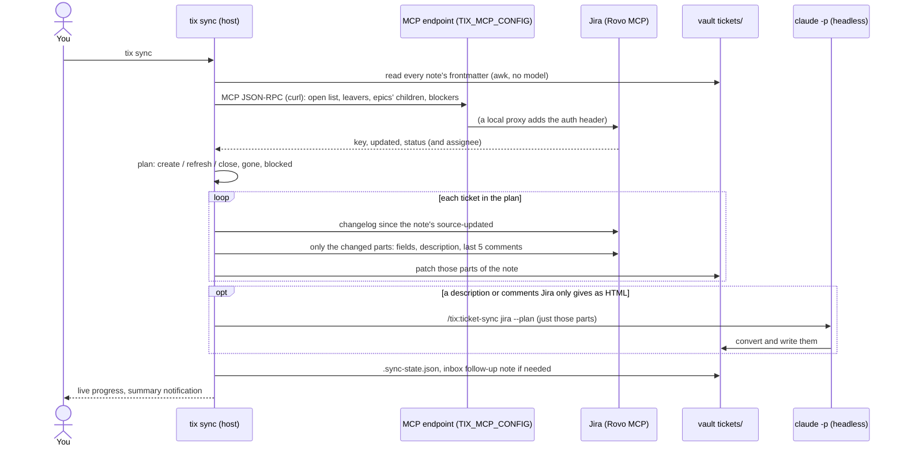
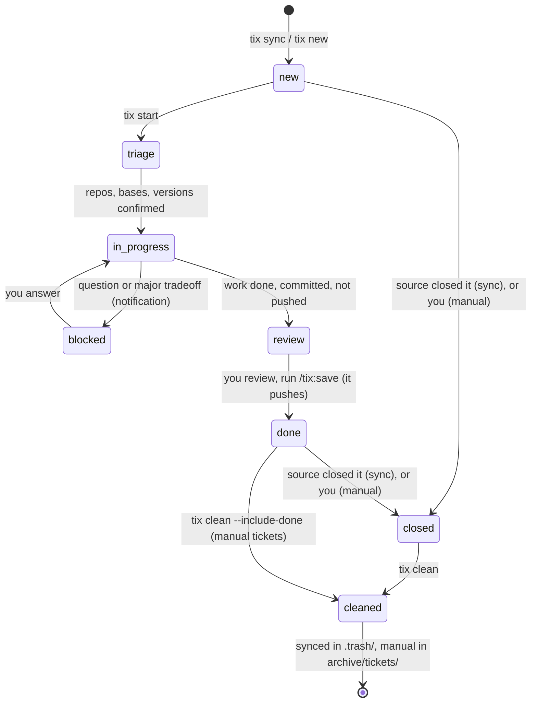
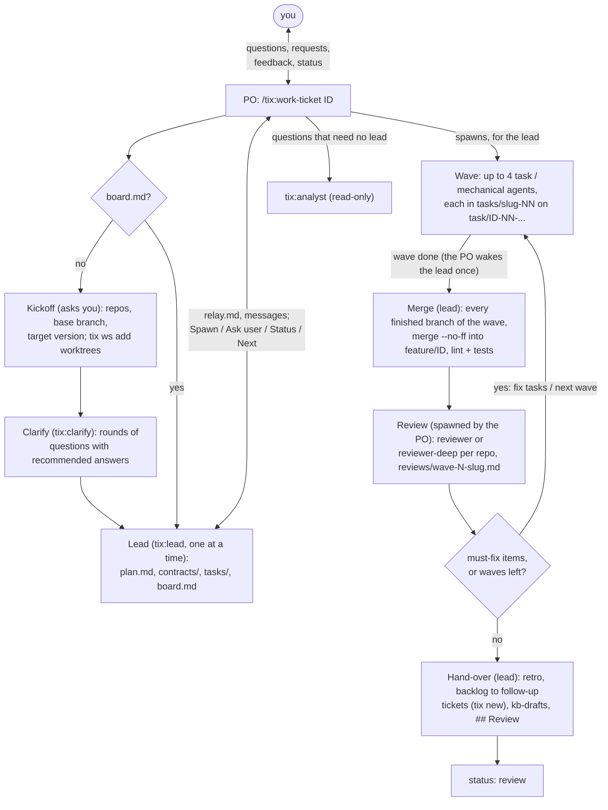
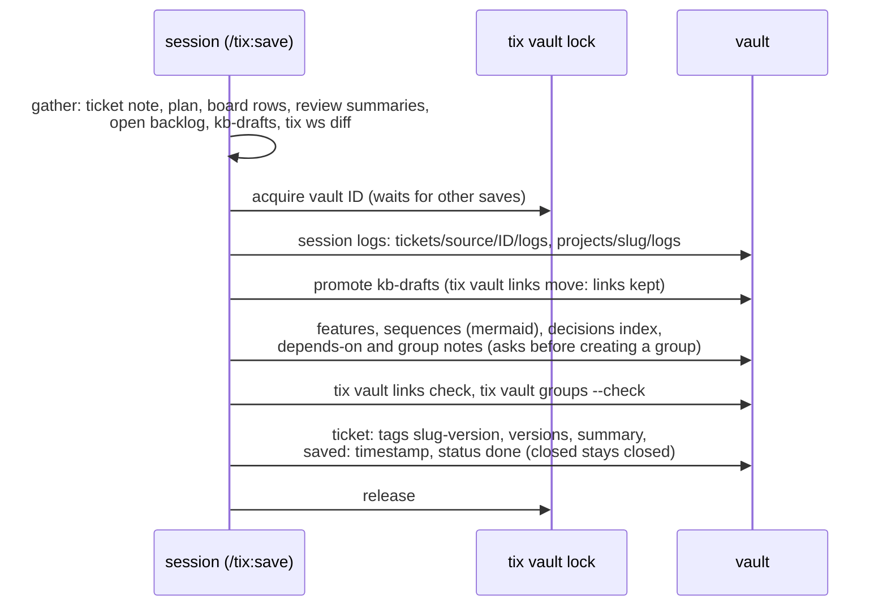
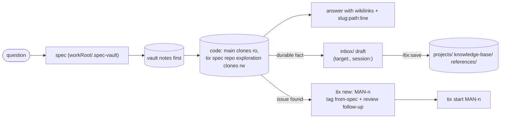
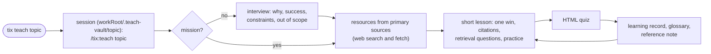

# tix

Parallel Claude Code sessions that work tickets end to end, with an Obsidian
vault as their long-term memory. You stay in charge of the final review:
agents commit on the ticket branches, and `/tix:save` pushes them once
you have reviewed the work.

What it gives you:

- **Ticket sync:** your open tickets from Jira (or any source with an MCP
  server and an adapter) are pulled into the vault, unsupervised. Manual
  tickets are written in the vault and never synced.
- **One session per ticket:** each runs in the terminal you start it from
  (one ticket per terminal; `tix status` shows them all). The session is the ticket's
  product owner (PO): you talk to it, it clarifies the ticket with you first,
  and it runs a lead agent that plans the ticket and works it in waves of
  small task agents, each in its own task worktree, with a review agent
  after each wave. New requirements, feedback and questions go to the PO at
  any time. Each session keeps a board of its tasks in the ticket folder
  and gets its own git worktrees, and you get one desktop notification
  when it needs you (a question, a permission prompt, or waiting for your
  reply with no agent running), which stays until you dismiss it.
- **Knowledge base:** the vault holds what the sessions learn: projects
  named by repo slug, the features and versions they shipped in, which
  projects work together (`depends-on`, optional groups), and flows across
  the projects that work together as mermaid diagrams. `tix spec` answers
  questions about the vault's projects without a ticket.
- **Learning topics:** `tix teach <topic>` teaches you a topic over many
  sessions from primary sources, with short lessons, quizzes and a record
  of what you know, kept in the vault's `learning/<topic>/`.

Underneath it's a plain agent CLI: Claude Code by default, or kiro
(kiro-cli, v3 engine) per vault or per session (see [Agent CLIs](#agent-clis)).
Claude sessions run your `claude` command with standard flags
(`--plugin-dir`, `--add-dir`, `--settings`), kiro sessions your `kiro-cli`
with a generated agent (`chat --agent tix`), so they work the same
unsandboxed or inside a sandbox that wraps the CLI.

| Part | What |
|---|---|
| `cmd/tix`, `internal/` | `tix`, the one command (Go): every subcommand below, its shell completion (`tix completion zsh\|bash\|fish`); OS specifics in `internal/platform` |
| `assets/` | built into `tix`: `vault-scaffold/` (what `tix vault init` copies into a vault), `scaffold-history.json` (the hash of every version of those files ever shipped, so `tix vault update` knows an unedited old copy; `go generate ./assets`), `obsidian/` (the Tasks plugin pin and settings, shared with the Nix module), `plugin/` (below) |
| `assets/plugin/` | the plugin `tix` (Claude Code's format; rendered for kiro at each start, see Agent CLIs): skills (`/tix:work-ticket` (the PO), `/tix:po-refresh`, `/tix:clarify`, `/tix:retro`, `/tix:teach`, `/tix:pr-feedback`, `/tix:ticket-sync`, `/tix:spec`, `/tix:spec-init`, `/tix:save`, `/tix:recall`, `/tix:new-ticket`; the playbooks and methods the agents load: `tix:lead`, `tix:task-agent`, `tix:wave-review`, `tix:clarify`, `tix:diagnose`), the agents (`tix:lead`, the `tix:spec-writer` that `/tix:spec-init` spawns, and the `tix:task`, `tix:mechanical`, `tix:reviewer`, `tix:reviewer-deep` and `tix:analyst` agents the PO spawns), and the hooks that tell `tix status` what a session is doing. Some skills are adapted from mattpocock/skills (see Credits) |
| `testdata/`, `*_test.go` | the tests: `go test ./...` runs `tix` against a throwaway home with stub `claude`, `kiro-cli` and editor commands and real git, and `tix sync` against a fake Jira (`testdata/sync/`) |
| `nix/`, `flake.nix` | the package, a home-manager module, and Obsidian modules (Linux, Flathub) |
| `configure`, `Makefile` | building and installing without Nix |
| `.github/workflows/` | CI (tests on Linux, macOS and Windows; cross builds), run by hand for now |

The vault's own `AGENTS.md` is the rulebook the agents follow inside the
vault (note rules, ticket structure, who writes what). This README is the
operator's view.

## Install

**Nix (home-manager).** Add the flake as an input and import its module:

```nix
inputs.tix.url = "github:<you>/tix";   # or git+file:///path
# home-manager:
imports = [ inputs.tix.homeModules.tix ];
programs.tix.enable = true;
```

`nix profile install github:<you>/tix` works too, without the
module's settings (set the environment variables below yourself).
`homeModules.obsidianVaults` seeds vaults with the Tasks plugin (the same
pinned release `tix vault init` installs), its settings and the Minimal
theme (`programs.tix.obsidian.vaults`), and
`nixosModules.obsidian` installs the Flathub Obsidian scoped to the vault
folder (needs [nix-flatpak](https://github.com/gmodena/nix-flatpak)).

**Without Nix:** `tix` is one self-contained binary (the plugin and the
vault scaffold are built in; it unpacks the plugin to its cache). From a checkout:

```sh
./configure                    # or --prefix=$HOME/.local; checks what's missing
make
sudo make install              # tix and its zsh/bash/fish completions
```

`make uninstall` removes them; `make check` runs the tests, `make cross`
builds every OS/arch into `dist/`. Or `go install
github.com/zero4573/tix/cmd/tix@latest` (then `tix completion
zsh` for completion). What you need:

| Tool | For |
|---|---|
| Go 1.26+ | building `tix` |
| Claude Code (`claude`) | the sessions |
| git | worktrees |
| fzf (optional) | picking a vault interactively (else a numbered list) |

For zsh completion, put `<prefix>/share/zsh/site-functions` on `fpath`
(or `tix completion zsh > ~/.zfunc/_tix`).

| Platform | Status |
|---|---|
| Linux (amd64) | everything, including semantic vault search (`tix vault model fetch` installs the pinned llama.cpp build and model) |
| Linux (arm64) | everything except semantic search: no verified prebuilt llama.cpp is pinned, so `tix vault model fetch` says so and `tix vault search` uses keyword search only |
| macOS | everything except semantic search, for the same reason (no pinned llama.cpp for darwin) |
| Windows | the commands build and run natively; `tix start` runs the session in the console (no WSL needed). Untested; no semantic search either (no embedding build: keyword search only) |

Where `tix` keeps its own files (`tix vault` shows them):

| | Linux | macOS | Windows |
|---|---|---|---|
| settings (`config.json`, `default-vault`) | `~/.config/tix` | `~/Library/Application Support/tix` | `%AppData%\tix` |
| cache (unpacked plugin, embedding model) | `~/.cache/tix` | `~/Library/Caches/tix` | `%LocalAppData%\tix\cache` |
| logs | `~/.local/state` | `~/Library/Logs/tix` | `%LocalAppData%\tix\logs` |

`XDG_CONFIG_HOME`, `XDG_CACHE_HOME` and `XDG_STATE_HOME` are honoured on
every OS when set, and the `TIX_*` variables below win over
all of them.

Then set up a vault with `tix vault init <name>` (it creates it under
`~/Documents/Obsidian` if needed) and make it the default. It also
downloads and enables the Tasks community plugin (a pinned,
checksum-verified release from GitHub) when the vault doesn't have it, and
gives it the workflow's settings when it has none; `--skip-plugins` leaves
that out. An installed Tasks plugin is never replaced: Obsidian updates it
(Settings → Community plugins → Check for updates). With the Nix module,
both may seed a vault: they install the same version and settings, and
neither replaces an installed plugin.

## Configuration

Everything is optional. The home-manager module builds these into the
commands from `programs.tix.*` (so they apply right after a
switch, in every shell and terminal); an exported variable still wins.
Without the module, export them.

| Variable | What |
|---|---|
| `TIX_CLAUDE` | the claude command sessions run, with any extra arguments (default `claude`) |
| `TIX_KIRO` | the kiro command kiro sessions run, with any extra arguments (default `kiro-cli`); tix adds `chat --agent tix ...` |
| `TIX_AGENT` | the agent CLI sessions run, `claude` or `kiro`, over each vault's `.workflow.json` `"agent"` (`--agent` on `tix start`, `feedback`, `spec` and `teach` wins over both; default `claude`) |
| `TIX_SESSION_SETTINGS` | a Claude settings JSON merged into every ticket, spec and teach session's `.claude/settings.json`: your own rules (see below) |
| `TIX_MCP_CONFIG` | a standard MCP config (`{"mcpServers": {"<name>": {"type": "http", "url": …, "headers": {…}}}}`) naming each server the ticket sources use; `tix sync` talks to them directly. Sessions get the same servers from their own `claude` command; a read-only token is enough for everything but `/tix:new-ticket`, which files tickets at a source only when that token also has create scope (optional; Jira through Rovo: `write:jira:agent-interface`) |
| `TIX_MCP_PREPARE` | a command run before `tix sync` talks to them (e.g. starting a local proxy) |
| `TIX_NOTIFY` | `0` turns off the desktop notifications sessions send when they need you (e.g. when your own Claude hooks already notify) |
| `TIX_CONTEXT_WARN` | context sizes, in tokens and comma separated, at which a session warns once that its context is getting large (default `150000,200000,250000`); past the last one it warns on every prompt. A ticket session points at `/tix:po-refresh`, any other at `/compact` |
| `TIX_EDITOR` | editor of `tix open` (default: `ttt` when on PATH, else `code`) |
| `TIX_CONFIG_DIR` | settings dir (default: per OS, see Install) |
| `TIX_CACHE` | cache dir (default: per OS) |
| `TIX_STATE_DIR` | log dir (default: per OS) |
| `TIX_PLUGIN` | use this copy of the plugin instead of the built-in one (the Nix package sets it) |
| `TIX_EMBEDDER` | `none` turns the embedding model off (search is keyword-only); `stub` is for tests |
| `TIX_LIB_PATH` | extra absolute directories (PATH style) searched for the llama.cpp library and its runtime libraries; the Nix package sets it. `go test` and `make bench` with `TIX_EMBED_REAL=1` need no value on NixOS: they build `.#llamaRuntimeLibs` (libgomp, libstdc++) through nix when it is unset |
| `OBSIDIAN_ROOT` | where the vaults live (default `~/Documents/Obsidian`) |
| `TIX_TASKS_URL` | where `tix vault init` downloads the Tasks plugin release from: a mirror holding `<version>/<file>` (default: the GitHub releases); the checksums are always the pinned ones |

`TIX_VAULT` is set by the commands for the sessions they start
(so their tools act on the same vault); don't set it yourself. When a
sandbox wraps `claude`, let it pass `TIX_*` variables through.

### What sessions get

A ticket session runs, in its workspace:

```
claude --plugin-dir <plugin> \
  --add-dir=<vault> --add-dir=<projectsRoot> --add-dir=<each main clone's .git> \
  --permission-mode auto [--continue] "/tix:work-ticket <ID>"
```

(`--continue` only with `tix start --continue`, when the workspace ran a
session before, and then the prompt is a short nudge to redo the resume
instead of the skill command; by default each start is a new conversation), and the
workspace's `.claude/settings.json` holds the one rule the ticket
system needs: **tix's cache is never edited** (`Edit`/`Write`/`NotebookEdit`
denied under it; the plugin and model live there). The repo directory (`projectsRoot`)
is one writable `--add-dir`, not one per repo (each would add to every
session's context): sessions clone repos into it and add worktrees, and work
in the worktrees. A session can write the repo directory (`projectsRoot`): it may clone repos and add worktrees there. The sandbox keeps the `.git/hooks`, `.git/config` and git pointer files of existing clones read-only, and tix's own git refuses a repo whose config is off a safe list and runs with hooks, fsmonitor, credential helpers and unsafe protocols off. What is covered and what is not: [Git hardening](docs/git-hardening.md). `tix spec` and `tix teach` sessions also deny the file tools
in every repo. Its `env` puts Go's `GOPATH`, `GOMODCACHE` and `GOCACHE` under
`<workspace>/.cache/go`, so each session, in its own container, fetches
and builds modules in a folder it can write. `tix` writes
`<workspace>/.ignore` (`/.cache/`) so rg (Claude's Grep) skips the caches
unless a search names them, and removes a `.claude/graph-mcp.json` left by
an older tix. `tix ws rm` removes the caches with the workspace, and
`tix ws gc` drops them from workspaces with no running session. `TIX_SESSION_SETTINGS` is
merged in last, so your own `env` wins. A sandbox can read
the same flags and rules to decide what to mount, and how.

A dev workspace (`tix start --dev <slug>`, for a ticket that changes
tix itself, so its sessions follow the rules it is writing) is
recorded in `workspace.json` (`"dev": {"slug": ...}`) and kept for later
starts until `--dev none`. `<slug>` must be a repo of the workspace with
`cmd/tix` and `assets/plugin`. At each start, tix runs `go build -o
<workspace>/.cache/dev/bin/tix ./cmd/tix` in that checkout (with the
workspace's Go env; a failed build fails the start), copies the checkout's
`assets/plugin` to `<workspace>/.cache/dev/plugin` with its hooks pointed at
the built tix, and prints `dev mode: plugin and tix from <slug> (<short
HEAD>)` (`-dirty` when the checkout has uncommitted changes). Sessions get
`--plugin-dir` of that dir, `<workspace>/.cache/dev/bin` prepended to the
`PATH` they start with (the launch environment; never written into the
settings). They also get
`TIX_DEV_BIN=<workspace>/.cache/dev/bin`: a sandbox or container
wrapping `claude` that sets its own `PATH` prepends it there (it is in the
workspace, so the same path exists inside), or skills and hooks run the
installed tix. The installed tix only builds (`go build`; the go.mod
toolchain and module downloads still run on the host) and copies regular
files and dirs (a symlink or other special file in `assets/plugin`, or
`assets/plugin` itself a link, fails the start): it never runs the built
tix or other code from the checkout outside a session.
A running session keeps the build it started with: `tix start` refuses a
ticket whose session runs, so every start rebuilds. `tix clean --save` ignores the dev build: the unattended
`/tix:save` runs on the installed plugin and tix. `tix ws rm` and `tix ws
gc` remove the build with `.cache`.

### Agent CLIs

Sessions run Claude Code unless a vault, the environment or the command
says otherwise; the first of these wins:

1. `--agent claude|kiro` on `tix start`, `tix feedback`, `tix spec`, `tix teach`
2. `TIX_AGENT=claude|kiro`
3. the vault's `.workflow.json`: `{ "agent": "kiro" }`

A workspace records the CLI of its last session (`workspace.json`
`"agent"`): `--continue` continues only a conversation of the same CLI, else
it warns and starts a new one. `tix clean --save` and `tix sync` run Claude
Code whatever the vault says: tix reads its headless output.

A **kiro** session (kiro-cli 2.31+, v3 engine) runs
`$TIX_KIRO chat --agent tix [--resume] "/tix-<skill> <args>"` in its
workspace, where tix writes at every start:

- `.kiro/agents/tix.json`, the session's agent: a prompt naming the folders
  the session works in (kiro has no `--add-dir`), the commands it never runs
  (spec and teach: `git commit`, `git push`), `AGENTS.md` as a resource,
  `includeMcpJson`, and hooks that run `tix hook --agent kiro agent-state`
  for `tix status`
- the plugin, rendered for kiro: each skill as `.kiro/skills/tix-<name>/`
  (kiro skill names can't hold `:`, so `/tix:save` is `/tix-save`), each agent
  as `.kiro/agents/tix-<name>.json` (the `subagent_tix-<name>` tool, with
  `includeMcpJson` like the session's agent, or it would get no MCP
  servers), with
  every `tix:<name>` reference rewritten and a short table mapping the
  Claude tool names the playbooks use onto kiro's. Files of your own in
  `.kiro/` stay; `tix-*` ones are replaced
- `AGENTS.md` instead of `CLAUDE.md`, and no `.claude/settings.json`: the Go
  caches are in the session's environment

kiro's permission rules don't hold against a session trusted with every
tool, so the read-only folders (the repos of spec and teach sessions, the
model cache) are only enforced by a sandbox: every session, Claude's too,
gets the folders it needs as `SANDBOX_ADD_DIRS` (read-write) and
`SANDBOX_RO_PATHS` (read-only), colon-separated and added to any values
already in the environment, for a sandbox that mounts them. tix's own cache
isn't protected from a kiro session's file tools. kiro has no context-size
hook, so the `TIX_CONTEXT_WARN` warnings and the resume after a compaction
are Claude-only for now.

### Recommended session settings

Not required, but what the workflow was built with: sessions commit, and
push only through `/tix:save` (fast-forward pushes of the ticket
branches), but never force push, delete branches or tags, rewrite history
or remove workspaces, and can't relax their own rules. `git worktree remove` stays allowed: the
lead removes its task worktrees (under `<workspace>/tasks/`) after
merging them, and deletes their merged branches with `git branch -d`. For an Atlassian source, also deny the Rovo tools that cost credits
(`<server>` is the source's `mcp` name):

```json
{ "permissions": { "deny": [
  "Bash(git push --force:*)", "Bash(git push -f:*)", "Bash(git push --delete:*)",
  "Bash(git push -d:*)", "Bash(git push --mirror:*)", "Bash(git push --prune:*)",
  "Bash(git push --tags:*)", "Bash(git reset --hard:*)", "Bash(git branch -D:*)", "Bash(git clean:*)", "Bash(tix ws rm:*)",
  "Edit(.claude/settings.json)", "Write(.claude/settings.json)",
  "mcp__<server>__search", "mcp__<server>__getGraphContext",
  "mcp__<server>__getGraphObject", "mcp__<server>__addGraphContext",
  "mcp__<server>__getTeamworkGraphContext"
] } }
```

A deny rule matches the start of a command only (`git push origin
--force` gets past it), so keep the real guard on the remote side: a push
broker on the host, or branch protection, that refuses non-fast-forward
pushes and branch or tag deletes and moves.

To keep session context small, also deny the built-in tools ticket work
doesn't use. A deny rule naming a whole tool (no parentheses) drops the
tool's schema from the context, not only its use, for the session and its
subagents (same effect as `--disallowedTools`); measured on Claude Code
2.1.308. Which tools to drop is yours to choose; the workflow never needs
these:

```json
{ "permissions": { "deny": [
  "Artifact", "ArtifactCheck", "ArtifactComments", "ArtifactData",
  "SendFeedback", "ShareOnboardingGuide"
] } }
```

To have a ticket session compact by itself instead of waiting for you to
type the command `/tix:po-refresh` prints, set Claude Code's
auto-compact window a little above the last context warning
(`TIX_CONTEXT_WARN`, default 250k tokens). The PO checkpoints
its board and relay as soon as a warning appears, so a compaction loses
nothing, and tix's SessionStart hook sends it back to its board afterwards:

```json
{ "autoCompactWindow": 260000 }
```

Running sessions in a sandbox that keeps credentials out (no SSH agent, no
tokens: MCP servers behind a proxy that adds them) is recommended too. Give
it a signing-only key (an ssh-agent with just the commit-signing key, or
`gpg` with no other secrets) so sessions sign their own commits, and push
access through that broker; without them, sign and push from the host
yourself.

## Repos and slugs

Every repo is named by its **slug**, `<provider>-<owner>-<repo>`, derived
from its origin URL. For example, `bitbucket-acme-billing-service`
and `github-ato-dotfiles`. The main clone lives at
`~/Projects/<provider>/<owner>/<repo>`, and `tix layout` moves existing
clones there. The slug names the vault project folder, the version tags,
and the worktree folders, so names never collide
across providers or owners. `tix ws repos` lists them.

There is one clone of each repo, its main clone, and a ticket's checkouts
are worktrees of it. A session can clone a repo it turns out to need,
`tix ws clone <provider>/<owner>/<repo>` (an existing clone is left as it
is), then `tix ws add` it.

### Projects and groups

Each repo is a project in the vault (`projects/<slug>/`), standalone by
default, so a vault can hold unrelated repos as well as repos that work
together. A project lists the projects it needs in `depends-on`
(wikilinks on its index note, with a `## Depends on` table saying over
what). Projects that share flows, compatibility rules or decisions can
also join an optional **group**, `projects/<group>/<group>.md`
(`type: group`), through their `groups` property; `/tix:save` creates
one only after asking you. Projects linked either way, directly or not,
are related; the rest are unrelated. `tix vault groups <vault>` prints the
clusters, and the vault's `AGENTS.md` has the rules.


## Commands

| Command | What it does |
|---|---|
| `tix vault` | The current vault and where its workspaces and main clones are, and where `tix` keeps its settings, cache and logs. |
| `tix vault init [<vault>]` | Set a vault up: folders, `AGENTS.md`, templates, the `tickets.base` dashboard, `inbox.md`, then `tix vault configure` for the settings not made yet, and the Tasks plugin (downloaded when missing; `--skip-plugins` to leave it out). Keeps existing files (and records what it shipped in `.scaffold.json`); `tix vault update` brings them up to date. |
| `tix vault update [<vault>] [--dry-run] [--diff] [--take <file>]` | Bring the files `tix` ships into a vault (`AGENTS.md`, templates, `tickets.base`, `inbox.md`) up to date: missing ones are added, unedited old versions replaced in place, edited ones kept and reported (`.base` files are compared by their parsed YAML, so Obsidian reformatting one or dropping its comments isn't an edit, changing a view is; `--diff` shows the difference, `--take <file>` takes the shipped version and keeps the old one as `<file>.bak`; `<file>` is relative to the vault root or any path inside it), files a newer `tix` wrote (per `.scaffold.json`) kept and never downgraded, files no longer shipped reported and never deleted, except the retired task views (see "Vault layout and checklists" below). It also migrates the ticket folders (same section). `--dry-run` previews it. Settings and your own notes are never touched. |
| `tix vault configure [<vault>] [--section locations\|sources]` | The vault's settings, each prompt showing its current value: locations (`.workflow.json`, see below) and ticket sources (`tickets/.sources.json`). |
| `tix vault default [<vault>\|--pick\|--unset]` | The vault every other command acts on. Switch it to work on another vault. |
| `tix sync [--source <name>] [--full]` | Pull your open tickets from each enabled source and reconcile the notes, unsupervised. For Jira, it finds and writes only what changed, without a model; Claude only converts HTML-only descriptions or comments. |
| `tix new [--type <t>] "<summary>"` | Create a manual ticket `MAN-<n>`. |
| `tix ticket convert <MAN-n> --to <source> [--project PROJ] [--type T] [--dry-run]` | File a manual ticket at a synced source (e.g. Jira, through `TIX_MCP_CONFIG`), then move its vault folder to `tickets/<source>/<KEY>/` (files renamed, links following) and its workspace to `<KEY>` (worktrees repaired; the branch keeps its name). Refused while its session runs. `--project` falls back to a `project` key on the source in `tickets/.sources.json`; `--dry-run` shows what would be filed. It holds the vault lock while it runs. After a failure past the create, run it again to finish; after a lost response to the create, check the source project for the new ticket before re-running, so it isn't filed twice. The session's conversation starts fresh; run `tix sync --source <source>` to fill the note. |
| `tix start [--force] [--feedback] [--continue] [--dev <slug>\|none] <ID>` | Run the ticket's session in this terminal (one ticket per run; start others from their own terminals), in a workspace marked as trusted in Claude Code so the session starts right away (Tab completes the vault's open tickets; `--list` prints them; an ID that isn't in the vault's `tickets/` stops it before anything starts), running `/tix:work-ticket <ID>` (or `/tix:pr-feedback` with `--feedback`). Each run starts a new conversation, which resumes from the ticket's `board.md`; `--continue` (`-c`) reopens the workspace's last conversation instead (also on `tix feedback`). A ticket whose session runs is refused; one whose session only looks running (its `.agent-state`) needs `--force`. `--dev <slug>` makes it a dev workspace, for a ticket that changes tix itself: its sessions run the plugin and `tix` built from its checkout `<slug>` (see [What sessions get](#what-sessions-get)); `--dev none` goes back to the installed ones. |
| `tix feedback <ID>` | Shorthand for `tix start --feedback`: apply the review comments on your open Bitbucket PRs. A running session gets nothing typed into it: type `/tix:pr-feedback` in its terminal. |
| `tix status [-w] [--interval <d>]` | Every session: `needs-input` / `idle` / `working` / `exited` (`stale` when its process ended without the session ending), source, status, dirty repos. With `-w`, stays on screen and refreshes every 2s (`--interval`, at least 1s) and whenever a session changes state, until Ctrl-C; piped, it prints once. |
| `tix open <ID>` | Open the ticket's workspace in `$TIX_EDITOR` (default: `ttt` when on PATH, else `code`). `ttt` gets each worktree path, then the ticket's vault folder, as a multi-root open. For VS Code and its forks it opens `<ID>.code-workspace`: one folder per worktree plus the ticket's vault notes, so each repo gets its own source control. |
| `tix dir work\|tickets\|repos` | Print one of the current vault's directories: `work` the ticket workspaces, `tickets` the vault's `tickets/` folder, `repos` the repo directory (`projectsRoot`), going down through a provider or owner level that holds a single folder, never into a repo. tix can't change your shell's directory: `ctd() { cd "$(tix dir "$@")"; }` in your shell's rc file, then `ctd repos`. |
| `tix ws repos\|clone\|add\|ls\|diff\|diff-check\|mark\|marks\|refresh\|rm\|fetch\|gc\|tidy-clean` | Worktrees per ticket, on `feature/<ID>[-<desc>]` (a manual ticket's branch has no ID: `feature/<desc>`, so `add` needs `--desc` or `--branch`). Sessions run it to create their own. `mark <ID> tidy [<slug>...]` records, per repo, the commit where tidy was done and `marks <ID>` shows `ok`, `stale` (commits after it) or `none` per repo (exit 3 unless all are ok; `/tix:save` checks it before pushing); `refresh <ID>` rewrites the workspace's `CLAUDE.md` from the vault, as `tix start` does (the kickoff runs it once `board.md` names the commit style); `diff-check [-C <dir>] [--max-size 1M] [--ticket <ID>] <range>` flags binary or large files added by any commit of the range, and with `--ticket` the ticket's vault-only IDs a commit introduces (exit 3 when something is flagged; it also prints `note` lines for changed or removed existing tests and, with `commit.gpgsign` on, unsigned commits, which never change the exit code); `rm <ID> [--drop-ignored]` removes a ticket's worktrees and workspace files, and stops on every guard it finds, listing the items behind each (uncommitted changes, a submodule checked out, commits not on origin, and ignored files such as a changed `.env`); only the ignored-files stop has an override, `--drop-ignored` (a git repository inside an ignored folder is listed with its unpushed commits and, under the flag, moved whole to the vault's `.trash/`), and for the others you commit, push or stash the work (there is no force); `gc` frees disk (see below); `tidy-clean <ID> [--force] [--dry-run]` removes the tidy skill's scratch clones `<ws>/tasks/tidy-<slug>` (an unmerged one is kept unless `--force`). |
| `tix clean [<ID>...] [--dry-run] [--yes] [--save] [--include-done] [--keep-manual] [--purge] [--days N]` | Clean up closed tickets: remove the workspace, then move a synced ticket's folder to the vault's `.trash/` (links to it become `[ID](<source-url>)`; files other notes link or embed move to `archive/tickets/<source>/<ID>/`) and a manual one's to `archive/tickets/<source>/<ID>/`. Skips open tickets, running sessions, uncommitted or unpushed work (commits already in `origin/<base>`, e.g. squash-merged, count as pushed) and unsaved sessions (`--save` runs `/tix:save` headless first). Prints the plan and asks; `--yes` without a terminal. |
| `tix spec [--continue] [--print] ["<question>"]` | Ask about the vault's projects without a ticket: a session with the vault and every repo read-only. |
| `tix spec start <ID> <slug> [<capability>...]` | Make a ticket's copy of a vault-located spec, with a snapshot of `projects/<slug>/specs/` to diff against. Run by the spec skills. See [Vault spec versions](docs/spec-versions.md). |
| `tix spec promote <ID> [--json] [--resolve <slug>=theirs\|ours\|merged]` | Promote a ticket's specs into `projects/<slug>/specs/` with a version note per repo; refuses when another ticket changed the same files. Run by `/tix:save`. See [Vault spec versions](docs/spec-versions.md). |
| `tix spec pin <ID> [--refresh <slug>]` | Pin the ticket's spec versions to the pushed commit, after the push. See [Vault spec versions](docs/spec-versions.md). |
| `tix spec log <slug> [<capability>]` / `tix spec show <slug>@<rev> [<capability>]` (rev: a version ID, tag or commit) | The history of a vault-located spec by version, and the spec as of a version, tag or commit (`--diff` for the change). |
| `tix spec repo checkout\|fetch\|ls\|reset` | Inside a spec session: exploration clones of any branch, to build and test in (never committed). |
| `tix teach [--continue] [<topic>] \| --list` | Learn a topic (kebab-case) over many sessions: a session running `/tix:teach <topic>` in this terminal, with the vault and every repo read-only. No topic: pick one of the vault's `learning/*/` or type a new one (without a terminal it prints them and fails). A new conversation each time; `--continue` (`-c`) reopens the topic's last one. `--list` prints the topics. See "Learning a topic". |
| `tix claude [claude args]` | `claude` in the current repo with the vault as its knowledge base: the vault added, the plugin's skills, and the repo's project notes named in the system prompt. |
| `tix layout [--apply]` | Move repos into `<projectsRoot>/<provider>/<owner>/<repo>`. |
| `tix vault lock` / `tix vault links` | Used by `/tix:save`: serialize writes to shared notes, and move notes without breaking wikilinks. |
| `tix relay add <ID> --from <user\|po\|lead> --to <user\|po\|lead> --kind <kind> [--state <state>] <text>` / `tix relay state <ID> R-<n> <state>` | Append a line to the ticket's `relay.md` `## Open` (printing its `R-<n>`, one more than the highest in the file) or set a line's state, under an exclusive lock on `relay.md.lock` (30 s wait), so the PO and the lead never take the same id. The text is one line of at most 200 characters without ` · `, tabs or control characters; ids have at most 6 digits, and Closed summaries count toward the next id. |
| `tix relay close <ID> R-<n> <summary>` | Under the same lock, move the entry from `## Open` to `## Closed` as `R-<n> → <summary>`, keeping the last 40 Closed lines. |
| `tix cite check [--pin <repo>=<rev>] [--pins-from <note>] [--clone <repo>=<dir>] [--symbols] <note>...` | Check a note's code citations at the commits it pins (`<repo> `<branch>` @ `<sha>``): `path:line` and `path:N-M` references and captioned code chunks (`**<repo>** · `<path>` · … · lines N-M`). The file must be there, the lines inside it, and a chunk the file's text at those lines. One line per failure (`<note>:<line>`, citation, reason), exit 3. Investigation tasks run it before reporting. |
| `tix vault groups <vault> [<project\|group>...] [--json] [--check]` | Which projects work together (groups, `depends-on`, used-by) and which are unrelated; a name without a note is reported as standalone. `--check` validates those links, in the named notes or the whole vault (used by `/tix:save`). Read-only. |
| `tix completion zsh\|bash\|fish` | Shell completion (installed by the Nix package and `make install`): subcommands, flags, and ticket IDs with their summary. |

Every command acts on the **current vault**: the default one
(`tix vault default`), else the only vault under `$OBSIDIAN_ROOT`. Switch the
default to work on another vault. Only `tix vault init`, `tix vault configure`, `tix vault update` and
`tix vault default` take a vault name. Inside a ticket or spec workspace the
tools use that workspace's vault, so a running session stays on its vault
when the default changes.

### Per-vault locations

Each vault's `.workflow.json` says where its tools work, so several vaults
never share a workspace (a `MAN-1` exists in each):

```json
{ "workRoot": "~/Projects/work-<vault>", "projectsRoot": "~/Projects/repo-<vault>" }
```

The values shown are the defaults when a key is missing: each vault gets
its own folders. Point several vaults' `projectsRoot` at one folder to
share main clones. `tix status` only sees the
current vault's sessions, so switch back to reach the others.
`tix vault configure --section locations` sets the folders. It checks each
folder against every other vault's, and against this vault's other folder.
A folder that is the same as, inside, or around another one is listed with
what it overlaps, and kept only when you type `yes`. Sharing `projectsRoot`
is the common case (the vaults share main clones); sharing `workRoot` mixes
the vaults' workspaces.

### Tool versions

tix writes `<workspace>/.tool-versions` at every `tix start`, `tix ws add`,
`tix spec` and `tix teach`, so `go`, `gofmt` and `python3` work through the asdf
shims without `ASDF_*_VERSION` exports. The vault's `.workflow.json` sets the
other tools:

```json
{ "toolVersions": { "python": "3.13.7", "golang": "latest" } }
```

Each key is an asdf plugin name with a version or `latest` (the newest
installed). The setting merges over the defaults per key: setting only `python`
still gives golang at `latest`; a key set to `""` or `"none"` leaves that tool
out. A malformed `.workflow.json` or a non-string value gives the defaults and a
warning. tix owns the root file: it overwrites it on every write (a hand-written
one included) and `tix ws rm` removes it; a failed write is a warning. golang
comes from the `go.mod` of the workspace's repos (the `toolchain` line, else
the `go` line: the newest installed version of the same X.Y that satisfies it,
else the newest installed above it); the setting is its fallback for a workspace
without a `go.mod`. A tool with no installed version gets a warning
(`asdf install <tool> <version>`) and is left out. `tix ws rm` removes the file.

`tix ws fetch` and `gc` work on the current vault's workspaces only.
`tix layout` lays out the current vault's `projectsRoot`, but won't move a
main clone that any vault's workspace borrows objects from.

## Ticket flow

### Sync



Every run is a full reconciliation. The command finds the deltas itself,
with no model and only a few small API calls per changed ticket:

- **Which tickets:** open tickets with no note, or whose `updated` differs
  from the note's `source-updated`. Open notes missing from your open list
  are looked up by key: done ones are closed, reassigned ones refreshed and
  tagged `unassigned`, and keys Jira no longer returns (deleted, moved, no
  access) tagged `unassigned` with a follow-up task. Epics are refreshed when
  their children's set, status or assignee changes; the last state is kept
  in `.sync-state.json`. `blocked` is recomputed from the blockers' status
  and written directly.
- **What changed in each:** Jira's changelog since the note's
  `source-updated` decides which parts are rewritten:

  | Change | Rewritten |
  |---|---|
  | time tracking, rank, sprint, story points, ... | only `source-updated` |
  | status, assignee, summary, type, priority, versions, components, labels, links, parent | frontmatter and the source block's table (a status category of done closes the note) |
  | description or a text custom field (`textFields`) | `### Description` |
  | comments (Jira doesn't log them; the last five's ids and times are compared with the note's signature) | `### Recent comments` |
  | an epic's children | `### Children`, `children`, `covers`, `covered-by` on the children |

  A new ticket gets every part, and a missing parent epic is pulled in.

Claude (the source's `model` in `.sources.json`, default `sonnet`) only
starts for a description or comments that Jira can return only as HTML
(panels, @mentions, media), and gets just those parts. `--full` lets Claude
list and compare everything itself, as other sources (no command-side sync
yet) always do.

Sync owns only a ticket's `source-*` fields, the dependency fields, and the
`<!-- source:start -->` block. It never touches the agents' sections or
your `ignore*` flags. An ignored ticket is still synced; `tix start`
just skips it. Anything that needs you (a failed source or ticket, a ticket
that vanished or was reopened) becomes a task in an `inbox/` follow-up note
(see below).

### Lifecycle



`tix clean` takes a closed ticket out of `tickets/` once its work is saved
and pushed: a synced one goes to the vault's `.trash/<ID>/` (Obsidian's
trash; `--purge` deletes it), and every link to it becomes a link to its
source page, `[ID](<source-url>)`, except in the parts of synced tickets
tix sync writes (it would write them back). A manual ticket has no remote
page, so it moves whole to `archive/tickets/<source>/<ID>/`, where links to it keep
resolving (`--keep-manual` leaves it). `done` tickets need `--include-done`,
and never synced ones: the source still has them open, so tix sync would
re-create them. A lead goes with or after its covered tickets. It works
one ticket at a time under the vault lock, re-checking first, so an
interrupted run finishes when run again.

### Inside a ticket session

The ticket session is the **PO** (product owner), the one you talk to. It
runs one **lead** agent that plans the work in waves of small agents, and
spawns every agent the lead asks for (subagents can't spawn agents):



- **The PO** (`/tix:work-ticket`, the session itself) runs the
  kickoff, then clarifies with you (`tix:clarify`): rounds of questions, each
  with a recommended answer that "yes" accepts, one round for a clear
  chore and several for a vague feature. Facts it looks up instead of
  asking you, and "skip" ends it. For a blocker someone else owns, it
  offers a questionnaire for that person (`tix:clarify`). Then it
  spawns the lead and relays: the lead's questions to you (recorded under
  `## Questions`), your new requirements, features and feedback to the
  lead (as `relay.md` entries it plans into the next wave), and each
  spawned agent's completion. Questions that don't need the lead go to
  `tix:analyst` (read-only, at most 20 lines with `file:line`).
  Status updates are short and come from `board.md`. `/tix:clarify`
  clarifies new scope with you at any point.
- **The lead** (`tix:lead`, a background agent, never two at once,
  with no Agent tool) writes `plan.md`, fixes interfaces in `contracts/`
  before anything uses them, and writes one file per task in `tasks/`
  (goal, steps, checks, and the exact files it `owns`). Tasks whose files
  overlap never run in the same wave. The PO wakes it once per wave, when
  the last task or reviewer of that wave finishes (a blocked or failed
  task at once), and it merges every finished task branch into the
  ticket branch, runs the repo's lint and tests, and does follow-ups of up
  to 20 lines itself. It ends each run with a block the PO acts on
  (`Spawn:`, `Ask user:`, `Status:`, `Next:`), and is replaced by a fresh
  lead after each reviewed wave.
- **Agents:** `tix:task` (sonnet) implements one task in its own task
  worktree, commits there and appends a `## Report` of up to 40 lines to
  its task file; `tix:mechanical` (sonnet, low effort) does renames,
  fixture syncs and small follow-ups. After each wave, `tix:reviewer`
  (sonnet), or `tix:reviewer-deep` (opus) when the wave changes a
  contract or security-sensitive code, reviews each repo's new commits:
  at most 3 must-fix, 6 should-fix and 5 consider items. Must-fixes become
  fix tasks before the next wave; the rest go to fix tasks or `backlog.md`
  (at most 40 open items). These agents get no subagents or
  Atlassian tools.
- **Search:** Claude Code's Glob, Grep and Read, scoped to the worktree
  at hand.
- **The ticket folder** holds `plan.md`, `board.md` (one row per task and
  review, the resume point; its `lead:` and `po:` are the PO's), `relay.md`
  (you, the PO and the lead; capped), `backlog.md`, `tasks/`, `contracts/`,
  `reviews/`, `kb-drafts/` and `<ID>-status.md` (live task views of the folder; the PO
  creates it at kickoff and nobody edits it). The ticket note's `## Tasks` has one line
  per phase or wave; `## Questions`, `## Review` and `## Follow-ups` stay
  there. At hand-over the lead runs a short retro (`/tix:retro` runs
  one any time: fixes to the agents' environment), writes the changes it finds
  to tix itself as tasks in the vault's `tix-improvements/`, and offers to turn open
  backlog items into follow-up tickets (`tix new`).
- **Fresh context:** the PO resumes from `board.md` and `relay.md` in a
  few calls, so a new `tix start <ID>` (a new conversation by default)
  picks up where the last one stopped, with a fresh lead.
  `tix start --continue <ID>` reopens the last conversation and sends a one-line
  nudge instead of `/tix:work-ticket <ID>` (the conversation already holds the
  playbook): redo the resume from `board.md` and `relay.md`, as the agents of the
  last run are gone. When the PO's
  context grows, it suggests `/tix:po-refresh` at a quiet point: it
  checkpoints the board and relay and gives you the `/compact` to type,
  while the lead and workers keep running.
- **Ticket types** shape the plan, not the agents: a `bug` starts from a
  root cause (`tix:diagnose`: a tight pass/fail loop first) and a
  regression test that fails before the fix; an
  `investigation` ends in `investigation.md`, with code only if asked; a
  `chore` may be one task or none; an `epic` plans over the tickets it
  covers.
- **Questions:** the PO stops and asks when something is unclear or a
  tradeoff is big. The hooks set the session to `needs-input`, which
  `tix status` shows and a desktop notification announces.
- **Dependencies:** `blocked-by` / `blocks` / `parent` / `related` in the
  frontmatter. An `epic` is a lead ticket: it `covers` other tickets
  (which point back with `covered-by`) and works them from one session,
  including children assigned to others, so it can ask you to follow up.
- **Filing tickets:** ask a session (the PO, `tix spec`) for a new ticket, or
  run `/tix:new-ticket`: it drafts it at the current ticket's source
  (under the current epic when the ticket is one), confirms the source and
  the draft with you, files it through the source's MCP server, and links
  it from the ticket's `## Follow-ups`; the next `tix sync` brings its note
  in. Filing at a source needs a token with create scope (optional; for
  Jira through Rovo, `write:jira:agent-interface`). Without it, or on a
  refusal, it offers a manual ticket (`tix new`) instead.
- **Committed, pushed by `/tix:save`:** sessions commit on the ticket
  branches with your git identity, signed when the session has a signing
  key. Nothing is pushed until you run `/tix:save` after your review:
  it checks that tidy was done after the last commit
  (`tix ws marks <ID>`), that every commit to push is signed, then pushes
  each repo's ticket branch (`git push -u`), never forced, never a task
  branch. A rejected push, unsigned commits, a force push or a branch or
  tag delete are yours to do on the host. Which pushes a session may run
  is your rule to set: see "Recommended session settings".

### /tix:save

`/tix:save` is the only writer of the shared notes (`projects/`,
`knowledge-base/`, `references/`):



The `saved:` timestamp tells `tix clean` the ticket's work is in the vault
(tickets saved before it existed are recognized by their summary block).


## Vault search

`tix vault search "<query>"` finds the notes and sections that answer a question, ranked by
embedding similarity, keywords (BM25) and links; `tix vault related <note>` finds similar
notes; `tix vault note outline|get|set-section|append|frontmatter` reads or writes one
section, leaving every other byte as it was (writes follow the vault's write rules, and
`/tix:save` passes `--save`). The skills use them to find context without reading whole
notes.

```sh
tix vault model fetch                                   # once, on the host: model + llama.cpp lib
tix vault search "how does sync dedupe tickets" --project acme --budget 2000
tix vault note outline acme-architecture
tix vault note get acme-architecture "Data flow"
```

The index lives in `<vault>/.tix/` (rebuildable, never edit it; searches update it
incrementally, `tix vault index` does it explicitly). The model is downloaded into
`<cache>/models/` on the host; sessions in a sandbox or container must be able to read that
directory, since they can't fetch it. Without the model, search is keyword-only and says so.

Specs are searched too. A repo whose specs live in the repo (`specs/` in its main clone) is
read from the clone's default branch, not the working tree, into one index per repo under
`<cache>/spec-index/<slug>/`, rebuilt when that `specs/` tree changes (a search checks it
first); its results are `<slug>:specs/<capability>/spec.md`, with type `spec` and project
`<slug>`. Specs kept in the vault are notes and are found as such. `--type spec` searches only
specs, `--no-specs` leaves them out (a repeated `--path`, which names vault folders, leaves out
the repos' specs).

```sh
tix vault search "when is a payout retried" --type spec
tix vault search "payout" --no-specs
```

`make bench` compares the token cost and latency of search against grep-and-read on a generated
2,000-note vault. The generator plants each fact and its distractors with the questions' own
vocabulary, so with the default stub embedder the numbers are a regression guard (budget,
latency, a keyword-only quality floor), not real-vault numbers. For the real model run
`tix vault model fetch` on the host, then `TIX_EMBED_REAL=1 make bench`.

## Knowledge base without a ticket



- **`tix spec`** fetches every main clone first, then opens a session with the
  vault and all repos (read-only).
- **`tix spec repo checkout <repo> <ref>`** makes a shared clone in the session
  to read in place of the main clone. You can build and test in it; it's
  never committed.
- **`tix spec --print "<question>"`** answers once, headless, logging to
  `spec-<vault>.log` in the log dir.
- **`tix claude`** in any repo gives the same skills (`/tix:spec`,
  `/tix:recall`, `/tix:save`) to a plain session. A plain `claude`
  session knows nothing of the vault.

## Learning a topic



- **`tix teach <topic>`** (kebab-case, e.g. `rust-async`) opens a session
  running `/tix:teach <topic>` in this terminal, with the vault and every repo
  read-only for examples. Without a topic it
  lists the vault's `learning/*/` and lets you pick one or name a new one;
  `--list` prints them. Each run is a new conversation that picks up from
  the topic's notes; `--continue` reopens the last one.
- **State:** the session works in `<workRoot>/.teach-<vault>/<topic>`
  (its `CLAUDE.md` names the vault and the topic), and writes only the
  vault's `learning/<topic>/`, directly and under the vault lock:
  `<topic>.md` (the mission and an index), `-resources`, `-glossary` and
  `-notes` (your preferences), `lessons/`, `reference/` (what you
  reread), `records/` (what you've shown you know) and `quizzes/`
  (self-contained HTML, linked from each lesson). Topics aren't tied to
  projects; related repos go in `projects:`.
- **Method:** a mission first; knowledge only from primary sources it
  finds on the web, and communities for judgement calls; each lesson just
  beyond what your records show, opening with retrieval questions on
  earlier lessons (spaced and interleaved); quiz answers of equal length
  in varying positions; one glossary kept to.

## Disk and cleanup

| What grows | Bound |
|---|---|
| Finished ticket workspaces, caches of stopped sessions, idle spec clones | `tix ws gc [--days 14] [--dry-run]`: keeps dirty or unpushed work, moves ignored files of the user's (a changed `.env`) and nested repos to the vault's `.trash/<ID>-ignored-files/`, deletes build and bulk ignored files (`node_modules`, `dist`) without a copy, refuses to run inside a container |
| Closed tickets' notes and folders | `tix clean [--dry-run]`: synced ones to `.trash/`, manual ones to `archive/tickets/`; keeps open, running, unsaved, dirty or unpushed ones, refuses to run inside a container |
| The tidy skill's scratch clones, `<ws>/tasks/tidy-<slug>` | `tix ws tidy-clean <ID> [--force] [--dry-run]`: keeps a clone whose bookmark isn't on the ticket branch; works in the sandbox, where `rm -rf` is denied |
| Logs (`*.log` in the log dir) | trimmed to the last 1 MB once past 5 MB |

`tix ws gc` is run by hand; a weekly timer is an easy addition. It leaves
running sessions alone: a session runs when its process is alive on this
host (`tix start`, `tix teach` and `tix spec` record it in the workspace's `.sessions.json`), else, when that
can't be checked, when its `.agent-state` is less than a day old and not
`exited`.

## Vault layout and checklists

`AGENTS.md` in the vault is a short rulebook (at most 200 lines: vault map, note rules, who
writes what). The workflow itself lives in the plugin's skills, shared prose in
`skills/work-ticket/workflow.md`.

- **`tickets/<source>/<ID>/`** is a ticket's folder: its note `<ID>.md` and everything the
  workflow keeps for it. `<source>` is the source's key in `tickets/.sources.json` (`jira`,
  `manual`, ...), the same as the note's `source:`; tix sync, the `ticket-sync` skill and `tix new`
  write there. Lookups by ID (`tix start PROJ-12`) find a ticket under any source folder.
- **`inbox.md`** (vault root) lists the open tasks in `inbox/`: the follow-up notes unattended
  commands leave (`type: follow-ups`) and any draft with tasks. The old task views `pending.md`,
  `done.md` and `follow-ups.md` are gone.
- **`tickets/<source>/<ID>/<ID>-status.md`** (from `templates/status.md`, created by the PO at kickoff and
  by `tix vault update` for existing tickets) shows the ticket's tasks live: Pending, Done and
  Deferred (`#deferred`), over its own folder. It carries no ID in its queries, so it keeps
  working after `tix clean` archives the folder.
- **Checklists:** checkboxes (`[ ]` todo, `[/]` in progress, `[x]` done, `[-]` cancelled, with
  `➕`, `✅`, `❌` dates) appear only in the ticket note's `## Tasks` and `## Follow-ups`,
  `board.md ## Tasks` (one line per task, status word after the ID), a review's
  `## Dispositions` and `backlog.md`; everywhere else in the ticket folder plain bullets. The
  status or disposition word decides the state, the box follows it.

### What `tix vault update` removes and migrates

Run it with no ticket session working (a running lead holds the old skills in context). It takes
the vault lock, then:
- **moves ticket folders** an older `tix` kept straight under `tickets/` (`tickets/<ID>/`,
  `archive/tickets/<ID>/`) to `tickets/<source>/<ID>/` and `archive/tickets/<source>/<ID>/`:
  the source is the note's `source:`, or, without one, the source whose `idPrefix` the ID
  has (else the one with no `idPrefix`). Bare `[[name]]` links keep resolving; path-qualified
  ones to the moved files are rewritten; the note moves last, so a run that stops is finished
  by the next. A folder whose new place is taken stays, with a warning. Start running sessions
  again afterwards (`tix start` rewrites the folder path in the workspace `CLAUDE.md`);
- adds `inbox.md` and `templates/status.md`, and **removes** the retired `pending.md`, `done.md`
  and `follow-ups.md` when unedited (an edited one is kept with a warning: delete it by hand);
- **migrates every ticket folder** whose note is not `status: closed`: writes a missing
  `<ID>-status.md`, converts `board.md` tables to one line per task and review, turns review
  `## Dispositions` and the open items of `backlog.md` into checklist lines. Files in another
  shape are left whole with a warning naming the line (`convert it by hand`); a second run
  changes nothing.

`--dry-run` and `--diff` print what would change and write nothing.

## Follow-up notes

Commands that run unattended leave what needs you in the vault, not only in
a terminal or log. Each run that has something writes
`inbox/<date>-<time>-<command>-follow-ups.md` (`type: follow-ups`), with one
Tasks-plugin task per item, so they appear in `inbox.md`:

| Command | Writes tasks for |
|---|---|
| `tix sync` | a source that failed or isn't set up, a ticket it couldn't update, one Jira no longer returns or reopened, problems Claude hit with an HTML part |
| `tix ws gc` | finished tickets whose workspace it kept (uncommitted or unpushed work) |
| `tix clean` | closed tickets it skipped for a reason you can act on (unsaved, a failed `--save`, uncommitted or unpushed work), and frontmatter links it couldn't rewrite |

Tick the tasks off and delete the note when done. `/tix:save` and the agents
leave these notes alone.


## Documentation

Architecture and flows, with diagrams, under `docs/`:

- [Architecture](docs/architecture.md): `tix`'s packages, the plugin, the layout on
  disk.
- [The ticket workflow](docs/ticket-workflow.md): PO, lead, waves, tasks and reviews as a
  sequence; the rules the skills enforce; `tix ws diff-check`; sandbox-safe checks; manual
  and synced tickets.
- [Finishing a ticket](docs/finishing-a-ticket.md): tidy, then save, which pushes;
  the marks and the push gate.
- [Workspaces and the vault](docs/workspace-and-vault.md): the vault, worktrees, branch
  names and `.tool-versions`.
- [Knowledge base and vault search](docs/knowledge-base.md): search, `tix spec` sessions, drafts.
- [Spec workflow](docs/spec-workflow.md): living specs, where they live, planning in
  `tix spec`, specs in a ticket, publishing to the source.
- [Vault spec versions](docs/spec-versions.md): `tix spec start`, `promote`, `pin`, `log`
  and `show`.
- [Workspace commands](docs/workspace-commands.md): `tix ws add`, `rm`, `gc` and
  `diff-check` with its notes.
- [Git hardening](docs/git-hardening.md): what protects tix's git calls in shared clones, and
  what stays exposed.
- [Session upkeep](docs/session-upkeep.md): context warnings, po-refresh, notifications.

## Troubleshooting

- **`tix sync` fails for a source.** Check that the source's `mcp` name
  is in `$TIX_MCP_CONFIG` and reachable, then the source's
  adapter (`assets/plugin/skills/ticket-sync/sources/<name>.md`) and the log,
  `ticket-sync-<vault>.log` in the log dir (`tix vault` shows where). For Atlassian, see the vault
  note `atlassian-rovo-mcp-setup`.
- **A session seems stuck.** `tix status` shows `needs-input` when it's
  waiting on you, and `stale` when its process is gone without the session
  having ended. It runs in the terminal where it was started.
- **Skills not found.** Plugin skills are namespaced: `/tix:save`, not
  `/save`.

## Credits

The `clarify`, `diagnose`, `retro` and `teach`
skills are adapted, in our own wording, from
[mattpocock/skills](https://github.com/mattpocock/skills) (MIT License).
The license text and which skill comes from which are in
[`assets/plugin/THIRD_PARTY_NOTICES.md`](assets/plugin/THIRD_PARTY_NOTICES.md).
