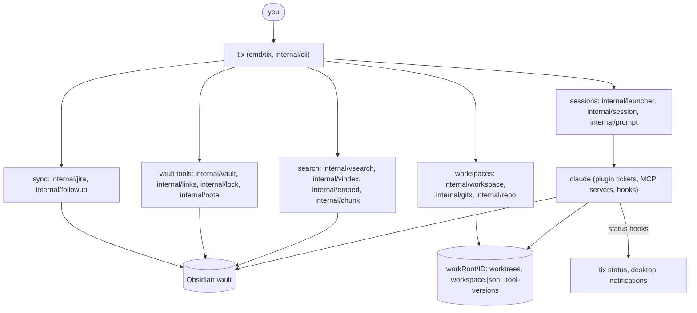

# Architecture

tix is one Go binary, `tix`, plus an Obsidian vault the agents use as long-term
memory. `tix` prepares workspaces and launches Claude Code sessions; the sessions do the
work, following the plugin's skills. Everything the plugin and the vault scaffold need is
embedded in `tix` (`assets/`); the plugin is unpacked to the cache on first use.

## Packages

| Package | Role |
|---|---|
| `internal/cli` | the cobra commands: `start`, `status`, `ws`, `vault`, `spec`, `ticket`, `teach`, `clean`, `sync`, `layout`, `claude`, `hook` |
| `internal/workspace` | a ticket workspace: `workspace.json` (repos, bases, branches, target versions), the tidy mark, the live sessions, the `.tool-versions` stamp |
| `internal/gitx`, `internal/repo` | git helpers (worktrees, unpushed commits), the config allowlist that every git call passes ([git hardening](git-hardening.md)), and the repo slug rules |
| `internal/spec`, `internal/ticketconv` | the spec parser, diff and vault versions ([spec workflow](spec-workflow.md), [versions](spec-versions.md)); manual-to-synced ticket conversion |
| `internal/diffcheck` | `tix ws diff-check`: binary, large, vault-ID and spec-ID checks of a commit range |
| `internal/vault`, `internal/config` | finding the current vault, its `.workflow.json`, tool versions |
| `internal/links`, `internal/lock`, `internal/vaultlock` | moving notes without breaking wikilinks, and the vault lock `/tix:save` takes |
| `internal/vsearch`, `internal/vindex`, `internal/embed`, `internal/chunk`, `internal/modelcache` | the vault search index and its embedding model |
| `internal/jira`, `internal/followup` | ticket sources and the follow-up notes `tix` leaves |
| `internal/launcher`, `internal/session`, `internal/watch` | running sessions in the foreground of this terminal, and the session state behind `tix status` |
| `internal/scaffold`, `assets/` | the vault scaffold and its hash history, the plugin |

## The plugin

`assets/plugin/` is the Claude Code plugin `tickets`. Its skills are the playbooks: the PO
(`work-ticket`), the lead, the task agent, the reviewer, and the closing steps
`tidy` and `save`. Its agents (`lead`, `task`, `mechanical`, `reviewer`, `reviewer-deep`,
`analyst`) and hooks are what `tix` passes to `claude` with `--plugin-dir`. The flow is in
[the ticket workflow](ticket-workflow.md).

## Layout on disk

- The vault: `tickets/<source>/<ID>/` (note, plan, board, relay, tasks, contracts, reviews),
  `projects/<slug>/`, `knowledge-base/`, `references/`, `inbox/`, `learning/`.
- The workspace: `<workRoot>/<ID>/` with `CLAUDE.md`, `workspace.json`, `.tool-versions`,
  one worktree per repo at `<ID>/<slug>`, task worktrees under `tasks/`, and `.cache/` (Go
  modules and build caches).
- Main clones: `<projectsRoot>/<provider>/<owner>/<repo>`; never edited, only their `.git`
  is written so worktrees can be created.

See [workspaces and the vault](workspace-and-vault.md) and
[the tix ws commands](workspace-commands.md) for the details, [session upkeep](session-upkeep.md)
for the hooks that keep a long session usable, and
[finishing a ticket](finishing-a-ticket.md) for the order of the closing steps.
