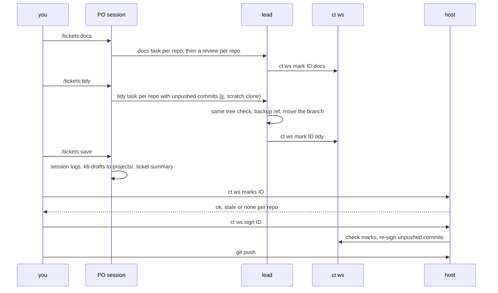

# Finishing a ticket: docs, tidy, save, sign

The order is fixed: docs, then tidy, then `/tickets:save`, then `ct ws sign`, then you
push. Sessions commit on the ticket branches and never push.

## Docs

`/tickets:docs` writes or updates markdown under `docs/` (an architecture page with a
mermaid flowchart, one page per main flow with a sequence diagram) and the README's
`## Documentation` section. Each page stays under 300 lines and every diagram label is
quoted.

## Tidy

`/tickets:tidy` rewrites the ticket branch's unpushed commits into coherent ones with
Jujutsu, in a scratch clone `.tasks/tidy-<slug>`, never in the ticket worktree. The result must
have exactly the same tree. Before moving the branch, the lead saves the old tip as
`refs/tidy-backup/<branch>` and updates the branch with the old value as a guard. Pushed
commits are never touched. The lead deletes the scratch clones with `ct ws tidy-clean <ID>`
(it keeps a clone it cannot show is merged: its bookmark is not yet on the ticket branch, or
the clone has no repo in the workspace, no bookmark or no `.git` of its own; it then exits
nonzero with a warning; `--force` drops it, `--dry-run` only lists). It works in the sandbox, where
`rm -rf` is denied, and touches nothing else under `.tasks/`.

## Marks

`ct ws mark <ID> <docs|tidy> [<slug>...]` records, per repo, HEAD, its tree and the time.
A repo with uncommitted changes is skipped with a warning and the command exits 1. A repo
whose worktree is missing is skipped with a warning. `ct ws marks <ID>` prints one line per
repo (`docs ok|stale|none tidy ok|stale|none`): `ok` means the marked tree is the current
one, `stale` means commits came after it, `none` means never marked. It exits 3 unless
every mark is `ok`. Because any later commit makes a mark stale, docs and tidy run last,
and tidy keeps the tree, so its mark follows docs.

## The sign gate

`ct ws sign <ID>` runs on the host, where the signing key is, and refuses inside a
container. It first checks the marks:

- every mark ok: it signs;
- some stale or none: it asks for confirmation, but only when stdin is a terminal. Without
  one it refuses; `--skip-marks` goes on without asking;
- a worktree that is gone is a warning, not an error, and the other repos are signed.

Signing replays each worktree's unpushed commits onto the same parent with `--gpg-sign`,
starting from the oldest unsigned one: same changes and authors, new hashes. Merge commits
stay merges, and commits already on a remote are left alone.
