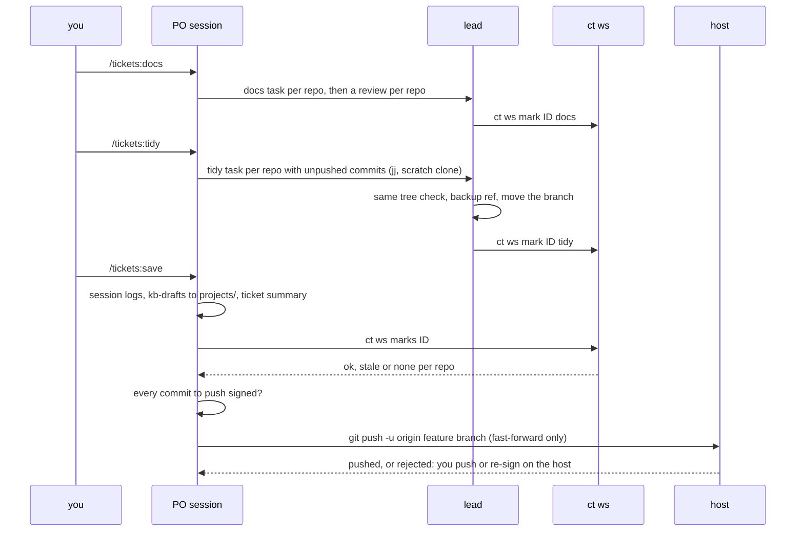

# Finishing a ticket: docs, tidy, save and push

The order is fixed: docs, then tidy, then `/tickets:save`, which pushes the ticket
branches. Sessions commit (signed, when the session has a signing key) on the ticket
branches and push only through `/tickets:save`: never a force push, a branch or tag
delete, or a task branch.

## Docs

`/tickets:docs` writes or updates markdown under `docs/` (an architecture page with a
mermaid flowchart, one page per main flow with a sequence diagram) and the README's
`## Documentation` section. Each page stays under 300 lines and every diagram label is
quoted.

## Tidy

`/tickets:tidy` rewrites the ticket branch's unpushed commits into coherent ones with
Jujutsu, in a scratch clone `tasks/tidy-<slug>`, never in the ticket worktree. The result must
have exactly the same tree. Before moving the branch, the lead saves the old tip as
`refs/tidy-backup/<branch>` and updates the branch with the old value as a guard. Pushed
commits are never touched. The lead deletes the scratch clones with `ct ws tidy-clean <ID>`
(it keeps a clone it cannot show is merged: its bookmark is not yet on the ticket branch, or
the clone has no repo in the workspace, no bookmark or no `.git` of its own; it then exits
nonzero with a warning; `--force` drops it, `--dry-run` only lists). It works in the sandbox, where
`rm -rf` is denied, and touches nothing else under `tasks/`.

## Marks

`ct ws mark <ID> <docs|tidy> [<slug>...]` records, per repo, HEAD, its tree and the time.
A repo with uncommitted changes is skipped with a warning and the command exits 1. A repo
whose worktree is missing is skipped with a warning. `ct ws marks <ID>` prints one line per
repo (`docs ok|stale|none tidy ok|stale|none`): `ok` means the marked tree is the current
one, `stale` means commits came after it, `none` means never marked. It exits 3 unless
every mark is `ok`. Because any later commit makes a mark stale, docs and tidy run last,
and tidy keeps the tree, so its mark follows docs.

## The push gate

`/tickets:save` pushes last, after the logs, kb-drafts, links, the ticket note and the
vault lock release. For each repo of the workspace (`workspace.json`), on its feature
branch only (never a `tasks/*` branch):

- the marks: `ct ws marks <ID>` must exit 0. When some are `stale` or `none`, save asks
  whether to save anyway; if you say yes it still asks again before pushing;
- the signatures: every commit to push (`git log --format=%G? <branch> --not --remotes`)
  must be signed. A repo with an unsigned one is not pushed: re-sign it on the host (for
  example `git -C <repo> rebase --exec 'git commit --amend --no-edit -S' <base>`, or fix
  the session's signing agent) and push it yourself;
- the push: `git push -u origin <branch>` (or the branch's configured remote). Never
  forced. A rejected push (not a fast-forward, or refused by the host's push broker,
  which rejects force pushes and branch or tag deletes and moves) stops that repo, and
  save prints the command to run on the host.

Rewriting pushed history, force pushes and branch or tag deletes are always your
manual steps.
