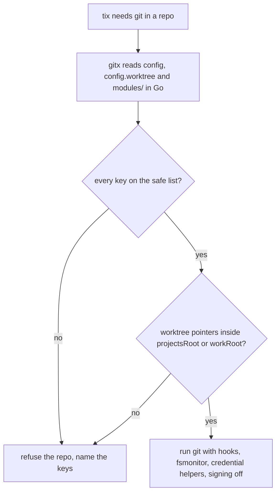

# Git hardening

A ticket session can write the repo directory (`projectsRoot`): it may clone repos and add
worktrees there, given as one `--add-dir`. A hostile or confused write to a clone's
`.git/config` could make a later git run a program. tix therefore reads git configuration
itself before it runs git, in the packages `internal/gitx` and `internal/repo`.

## Layers

- **Sandbox.** The `.git/hooks`, `.git/config` and git pointer files (`.git` files,
  `commondir`, `gitdir`) of clones that already exist are read-only for the session.
- **Config allowlist.** `gitx` parses the repo's own config files before running git and
  refuses the repo when any key is off the safe list, so a planted `core.fsmonitor`,
  `core.sshCommand`, `core.hooksPath`, `core.pager`, an `include`, an external filter or diff
  driver, a `protocol` or a `url.*.insteadOf` rewrite never runs. A symlinked or oversized
  config file is refused. Only `lfs` filters with git-lfs's own commands are allowed.
- **Remotes.** Only `https`, `ssh` and scp-like `user@host:path` URLs; an origin written as
  `host-alias:path` is refused outright.
- **Worktree pointers.** A worktree whose git pointer files lead outside
  `projectsRoot` or `workRoot` is refused. A session can write both folders, so this is a
  layout check, not a proof.
- **Command flags.** git runs with hooks, fsmonitor, `core.gitProxy`, credential helpers
  (`credential.helper=` resets the list, so one from your own config is off for tix too),
  signing, submodule recursion and every protocol but https and ssh off; diffs and logs that
  read patches use `--no-ext-diff --no-textconv`; `GIT_SSH_COMMAND` is yours or plain
  `ssh`; `GIT_DIR`, `GIT_WORK_TREE` and `GIT_CONFIG*` are removed from the environment.
- **Clone.** `tix ws clone` clones with `--no-checkout`, then checks out in the new clone,
  which tix checks like any other. Global and system git config are trusted.

## What stays exposed

- Your own git in a clone made during a session, until the next launch makes its config
  read-only: run it with `-c core.hooksPath=/dev/null` or read `.git/config` first.
- `.lfsconfig` in the work tree can redirect LFS URLs (network only, no program).
- The milliseconds between tix's check and git reading the file.
- A submodule's `core.worktree` pointing inside the work tree, and a local shared-clone
  source that passes the check.

`tix spec` and `tix teach` sessions also deny the file tools in every repo, so they can't
write a clone at all. Pushes go only through `/tix:save` and the host's push broker, see
[finishing a ticket](finishing-a-ticket.md).
