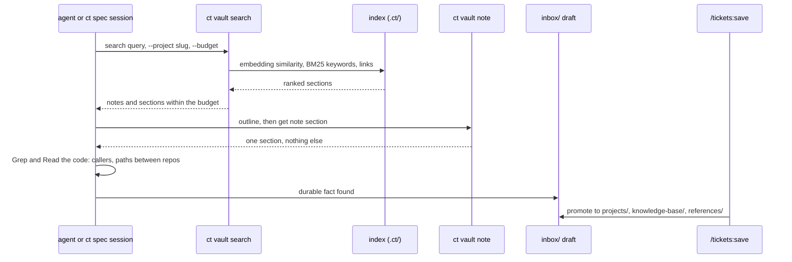

# Knowledge base and vault search

The vault's `projects/` notes describe each repo (by slug), what it depends on, the
features and versions it shipped, and the decisions behind them. Agents look there before
reading code, and `/tickets:save` writes new facts back.

## Search

`ct vault search` ranks sections by embedding similarity, BM25 and links. The index lives
in `<vault>/.ct/`, is rebuilt incrementally on search, and is never edited by hand.
The embedding model is fetched once on the host with `ct vault model fetch` into the
cache; a sandbox only reads it. Without the model, search is keyword-only and says so.
`ct vault note outline|get|set-section|append|frontmatter` reads or writes one section and
leaves every other byte as it was.

## Without a ticket

`ct spec "<question>"` opens a session with the vault and every main clone read-only. It
answers from the vault first, then the code.
`ct spec repo checkout <repo> <ref>` makes an exploration clone to build and test in; it is
never committed. A durable fact becomes a draft in `inbox/`; an issue worth following up
becomes a manual ticket with `ct new`. `ct claude` gives a plain repo session the same
skills.

## Relations between projects

A project lists what it needs in `depends-on`; projects sharing flows can join a group
note. `ct vault groups` prints the clusters and `--check` validates the links.
