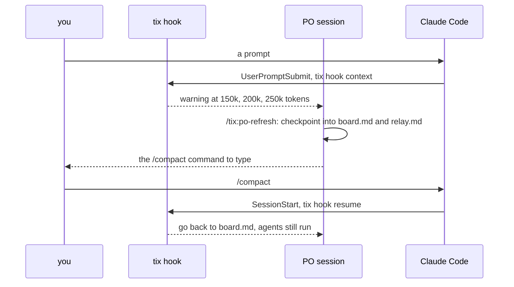

# Session upkeep

Sessions run in the foreground of the terminal that started them (one ticket per
terminal; `tix status` and the session PID records cover several). Three hooks keep a long
PO session usable. They are `tix hook` subcommands wired by the plugin.

## Context reminders

`tix hook context` reads the last reply's token usage from the transcript and, once each at
150k, 200k and 250k, shows a one-line warning and tells the PO; past the last it repeats on
every message. `TIX_CONTEXT_WARN` sets the thresholds. It is silent when it can't
read the size and never fails.

## po-refresh

Only you can type `/compact` or `/clear`, so the PO runs `/tix:po-refresh` itself on
the warning: it checkpoints what it holds only in chat into `board.md` and `relay.md`, then
prints the command. It clears when no lead or agent is running, else compacts; a clear
when it isn't safe asks to wait or compact. Every clear says how to resume
(`/clear`, then `/tix:work-ticket <ID>`). After a compact the resume hook points the
PO back at its board and tells it the agents are still running; each clear or compact is
logged in `<workspace>/.session-log` with the session id, marked `CHANGED` when it differs.

## Notifications

`tix hook notify` pings for `Notification` events (`permission_prompt`, `elicitation_dialog`,
`idle_prompt`) only when you are needed, once until you answer (a per-session flag cleared
by `UserPromptSubmit`), critical and kept on screen. No `idle_prompt` ping while the
board lists running agents. `TIX_NOTIFY=0` turns it off.
