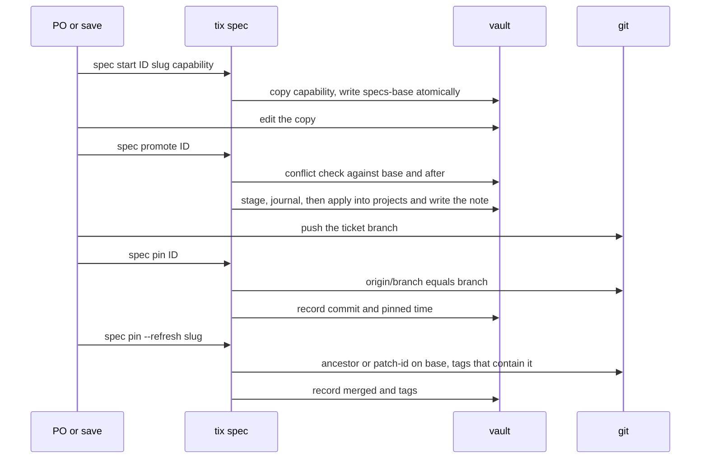

# Vault spec versions

A repo-located spec has git for its history. A vault-located one (`specs: vault`) gets
versions: each ticket that promotes a change is one version, pinned to the commit the
spec describes. For the spec model see [the spec workflow](spec-workflow.md).

```
tickets/<source>/<ID>/
  specs/<slug>/          working copy, made by tix spec start, emptied by promotion
  specs-base/<slug>/     projects/<slug>/specs/ as it was when the copy started
  specs-after/<slug>/    the files this ticket promoted, as its last promotion left them
  specs-stage/<slug>/    a promotion in flight (stage, journal), removed when it is done
projects/<slug>/spec-versions/<slug>-spec-<ID>.md    one version note per ticket
```

The version note is written whole by tix (the body is generated). Its frontmatter:
`type: spec-version`, `slug`, `ticket`, `project`, `promoted` (last promotion), `files`
(every file the ticket promoted, accumulated), `branch`, `commit` and `pinned` (empty
until pinned), `merged` (the base commit that holds it) and `tags`. The body names the
state (`Pinned to <sha> on <branch>, merged as <sha>, in <tag>` or `Unpinned`), links each
changed capability's before and after, and prints the requirement changes.



## Start

`tix spec start <ID> <slug> [<capability>...]` makes the copy folder, copies the named
capabilities from `projects/<slug>/specs/` (none: an empty copy for new capabilities; a
file already in the copy is kept) and, if `specs-base/<slug>/` doesn't exist, writes it as
a snapshot of the whole `projects/<slug>/specs/`. Every snapshot write is atomic
(`spec.WriteTree` writes a sibling temp folder and renames it).

A repeat run adds capabilities. For each file it copies, the snapshot is first rebased
onto `projects/`' current file (`rebased <file>`), so another ticket's earlier promotion
isn't this ticket's change. A file the ticket already promoted keeps its snapshot unless
another ticket changed it since. The snapshots are written behind a marker
(`specs-base/.<slug>.rebase`): a run that stops midway leaves it, `promote` refuses
while it exists, and the next `start` finishes the rebase. `start` also finishes a
pending promote journal of the ticket first, under the vault lock.

## Promote

`tix spec promote [--json] [--resolve <slug>=theirs|ours|merged]... <ID>` moves the copy
into `projects/<slug>/specs/` and records the version, per vault-spec repo of the
workspace. A copy without a `specs-base/` is an error naming `tix spec start`.

1. Conflict check: a copy file whose `projects/` version differs from both the base and
   the after snapshot was changed by another ticket. The repo is refused and nothing is
   written; the output names the files, the other ticket's version note, both requirement
   changes (theirs, ours) and where both changed the same requirement or interface.
2. Stage and journal: the plan (new base, new after, kept list, version note, moved
   files) goes into `specs-stage/<slug>/`; a journal written last is the commit point.
   Operations then run in order, each idempotent, each logged to `.journal.done`.
3. A run that fails after the commit point is finished by the next `promote` (or `start`).
   A replay holds back any file whose `projects/` content changed since the plan; it
   becomes an ordinary conflict.

A refusal has three exits: keep theirs (`--resolve <slug>=theirs` drops the copy's
conflicting files; they are listed in `specs-after/.<slug>.kept`), keep ours (`=ours`
replaces them) or merge by hand and rerun with `=merged`. While a journal or rebase marker
is pending, `tix spec diff` and `show` of that ticket refuse; `log` annotates it and `pin`
skips it; other tickets read as usual. Exit 1 when any repo was refused; `--json` prints
the same as data with `status` `promoted`, `nothing` or `refused`.

One version per ticket: a repeat promotion keeps `specs-base/`, adds to `files`, replaces
`specs-after/` (its own files only, never the rest of `projects/`) and moves `promoted`.
When the after tree changes in any of `files`, the pin is cleared.

## Diff

`tix spec diff [--stat] <ID>` for a vault spec: before the first promote, the copy against
`projects/` (or, with a snapshot, against its start); after it, `specs-base/` against the
base with the promoted files from `specs-after/` and the copy laid on. `projects/` isn't
read, so another ticket's later promotion never enters this ticket's diff or description.

## Pin

`tix spec pin <ID>` runs after the pushes. For each repo with a version note it records
`commit` and `pinned` only when the worktree's `origin/<branch>` equals its `<branch>`,
and prints `<slug>: pinned <sha>`, `already pinned` or `not pushed, left unpinned`. The
pushed head is the first SHA that won't change: tidy rewrites only unpushed commits. A save
that doesn't push leaves the version unpinned and the next one pins it.

`tix spec pin --refresh <slug>` resolves, in the main clone (after `tix ws fetch`), each
pinned version without `merged`: the commit if the base holds it (a merge), else the first
commit on the base since the pin whose `git patch-id --stable` equals the branch's (a
squash; one with conflict fixes isn't found), plus `tags` that contain it. Pin writes the
notes under the vault lock and fails naming the holder when another session has it.

## Log and show

`tix spec log <slug> [<capability>] [--json]` lists versions, newest promotion first: ticket,
date, pinned commit and branch (or `unpinned`), `merged <sha>` or `not found on <base>`,
the first tag, then the requirement changes per capability (`+` added, `-` removed,
`~` changed, status flips as `from→to`). It resolves merged and tags at read time without
writing. For a repo-located slug it prints the base's git log of `specs/`.

`tix spec show <slug>@<rev> [<capability>] [--diff]` prints the spec as of `<rev>`: a ticket
ID with a version note, or a tag or commit (the newest version whose merged or pinned
commit it holds, so `@v1.4.0` is the spec at that release; an unpinned version never
matches). `--diff` prints that version's change. A repo spec reads git at the rev.

Save runs these in order: `promote` before its link check, `pin` and `pin --refresh` after
the push, then publishes the description. Tidy runs before the save that pushes, so the
pinned SHA is final.
