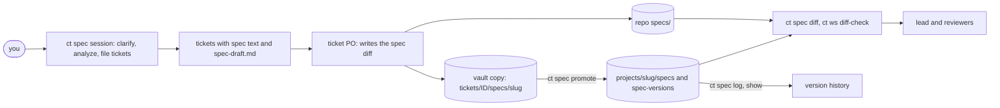
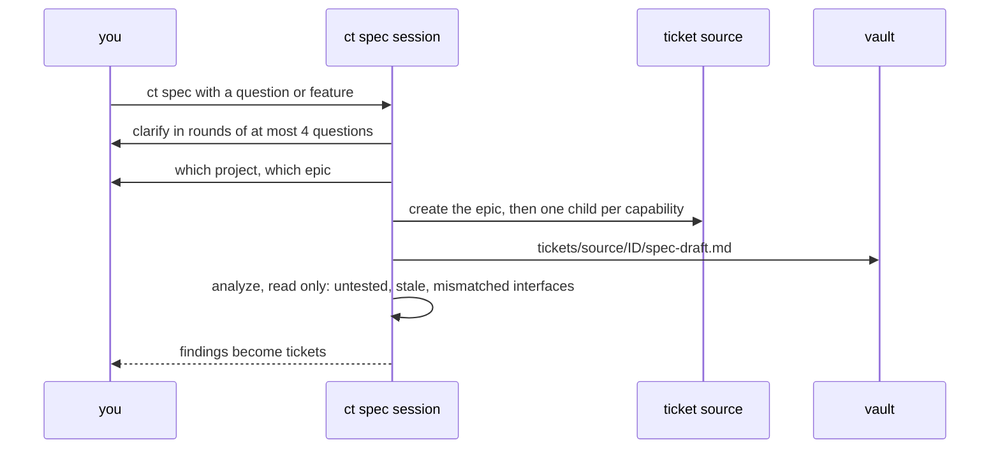
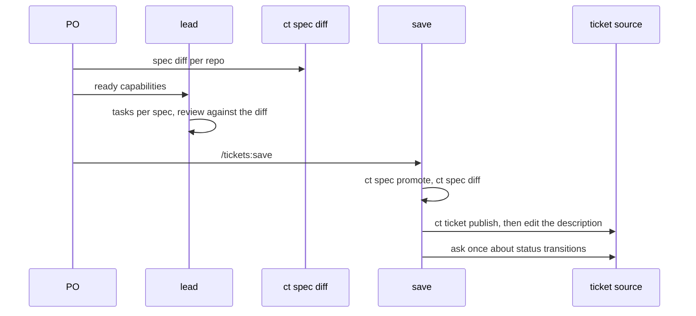

# Spec workflow

A repo describes what it does in living specs, one per capability, named by what the
capability does, never by ticket. A ticket changes the specs on its branch and the diff
against the base is the change. The vault stays personal: working state, why, history, and
what a ticket itself can't hold.

| Where | What | Named by |
|---|---|---|
| repo `specs/` | requirements, scenarios, interfaces (current state) | capability |
| vault `projects/<slug>/specs/` | the same, for a repo that keeps no specs | capability |
| vault `projects/<slug>/spec-versions/` | one note per ticket that changed a vault spec | slug and ticket |
| vault `tickets/<source>/<ID>/` | plan, board, relay, tasks, reviews, `spec-draft.md` | ticket ID |
| ticket description | the spec change in readable form, for teammates | ticket |



## Layout and format

```
specs/
  README.md                # capabilities, interfaces provided and consumed, cross-repo flows
  <capability>/spec.md     # Purpose, Requirements, Interfaces
```

A requirement is a block: a heading `### REQ-<PREFIX>-<n> · <title>` (the ID matches
`REQ-[A-Z][A-Z0-9]{1,7}-[1-9][0-9]*`), a `status:` line, the SHALL sentence, and
`#### Scenario: <name>` blocks of WHEN, THEN and AND lines.

- `status` is `proposed` (written, not built), `implemented` or `inferred` (drafted from
  code with `file:line` evidence; a person confirms it).
- An open question is a `[NEEDS CLARIFICATION: ...]` line under the requirement; such a
  requirement can't be filed in a ticket or planned by the lead.
- Bugs use three parts: current behavior, expected behavior, behavior that must not change.
- Tests cite requirement IDs; each scenario has a test.
- Two branches can pick the same new ID: `ct ws diff-check` flags a `spec-id` for an ID a
  branch adds that the other side already defines, or that it defines twice.

`ct spec check [--json] [--dir <path>] [<slug>...]` checks specs for duplicate IDs,
malformed blocks, open markers, untested requirements and interfaces where one repo's
"provides" doesn't match another's "consumes".

## Where specs live

By default in the repo's `specs/`. A repo not set up for them keeps them in the vault at
`projects/<slug>/specs/` (same layout), and nothing spec-related goes into it. The project
note records the choice as `specs: repo|vault`. `ct spec location <slug> [repo|vault]`
prints or records it. Whoever first needs a repo's specs and finds neither `specs/` nor the
field asks the user once.

A vault spec changes on a ticket in a working copy, which a later step promotes
(see [spec versions](spec-versions.md)); the ticket description still carries the change.
Moving a vault spec into its repo is a ticket that copies the folder and flips the field.

## Who writes specs

Only main sessions: a ticket's PO, `ct spec`, `ct claude`. The PO owns the spec diff and
talks to the user about it. The lead owns the plan and tasks and reads the change with
`ct spec diff <ID>` (the repo's `specs/` against its base, or the vault copy against
`projects/`). Interfaces between tasks go in the capability's Interfaces section. `ct spec`
is read-only on repos: its output is tickets, never commits.

## Planning in `ct spec`



1. Clarify the feature in rounds of up to 4 questions, the decisions that change most
   first; skipped ones stay as clarification markers.
2. Ask which project, find or create the epic, then file one child per capability or
   slice. Each description carries the spec change, self-contained.
3. Write what doesn't fit into `spec-draft.md` in the ticket folder; `ct sync` leaves it.
4. Analyze (read-only); findings become tickets.

`/tickets:spec-init <dir>` bootstraps a repo's specs as a ticket: gather the project
notes, graph communities, docs and tests; gate on a capability list the user approves;
one subagent per capability drafts `spec.md` with `inferred` requirements; then
`specs/README.md` and a `docs/architecture.md` skeleton. It is shallow on purpose.

## In a ticket

| Step | With specs |
|---|---|
| Kickoff | reads `spec-draft.md` and the affected specs; the PO writes the spec diff |
| Clarify | per capability; a capability with no open markers is marked ready and the lead told at once |
| Lead | schedules ready specs: tasks of different specs run together when their owned files don't overlap; a spec that consumes another's interface waits for it to merge |
| Tasks | cite requirement IDs; tests cite them too |
| Review | checks the diff: every `proposed` requirement implemented, tested, then `implemented` |
| More scope | clarify, then a child ticket under the epic, added to `covers` |
| Save | promotes vault copies, writes `specs:` and `requirements:` on the ticket note, publishes the change to each synced ticket's description, offers status transitions |



Publishing needs the source's MCP tools: without them save skips it and names the manual
tickets it skips. `ct ticket publish <ID> [--dry-run] [--allow-empty] [--description-file <path>|-]`
rewrites the marked `## Spec change` section and refuses to blank a non-empty one when it
finds no change (`--allow-empty` clears it when the change was reverted); `ct ticket stub` files a child's stub note under the lead until `ct sync`
fills it.

## Commands

| Command | Does |
|---|---|
| `ct spec` | the planning and question session (replaces the old `ct kb`) |
| `ct spec location`, `check`, `diff [--stat] <ID>` | location, checks, the ticket's spec change in every repo |
| `ct spec start`, `promote`, `pin`, `log`, `show` | vault spec versions, see [spec versions](spec-versions.md) |
| `ct spec repo checkout, fetch, ls, graph, reset` | exploration clones for building and testing, never committed |

`ct vault search` indexes each main clone's `specs/` and the vault's own, and skips the
version snapshots (`specs-base/`, `specs-after/`, `specs-stage/`): old copies would
outrank the living spec. The vault's `features/`, `data/` and single-repo `sequences/`
notes are retired in favour of the specs.
