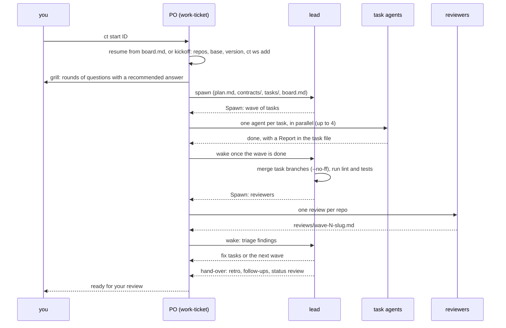

# The ticket workflow

`ct start <ID>` opens a session that runs `/tickets:work-ticket <ID>`. That session is the
product owner (PO). It talks to you, runs one lead agent, and spawns every agent the lead
asks for, because subagents cannot spawn agents. The lead plans in waves of small tasks.
Each task runs in its own worktree under `.tasks/` on its own branch, and the lead merges
the finished branches into the ticket branch.

## Who writes what

- The PO owns `board.md`'s `lead:` and `po:` fields and `relay.md`, the channel between you,
  the PO and the lead. It answers status from `board.md`.
- The lead owns `plan.md`, `contracts/`, `tasks/` and the board rows, merges branches, and
  ends each run with a block the PO acts on (`Spawn:`, `Ask user:`, `Status:`, `Next:`).
- A task agent writes only the paths its task file `owns`, commits in its task worktree and
  fills the task's `## Report` (at most 40 lines).
- Reviewers write one file per repo under `reviews/`, with capped must-fix, should-fix and
  consider lists.

## Parallel tasks and the lead skill

At most 4 agents run at once. Tasks whose `owns` overlap never share a wave. Concurrent
tasks in one Go package get distinct name prefixes for their helpers and `Test` functions
(set in each task file), so the names cannot clash when the lead merges the branches.

The lead's `SKILL.md` keeps the playbook short. Detail read at one moment sits in
`reference.md` next to it, under headings `SKILL.md` points to: the board-line recipe, the
review disposition formats, the gate script that checks every review finding has a
disposition, and how each ticket type shapes the plan.

## Checks that run in the sandbox

Sessions often run sandboxed, as root, with no network and no signing key.

- `.tool-versions` in the workspace root pins `go`, `gofmt` and `python3` through asdf, so
  the tools work without `ASDF_*_VERSION` exports.
- Go caches live under the workspace (`.cache/go`), not in the home.
- Each repo's own `AGENTS.md` names its check command (here: `make check`, which bounds
  test parallelism with `TESTFLAGS`). Tests never rely on file permissions, since root
  ignores them.
- Commits are unsigned in the sandbox. `ct ws sign` re-signs them on the host, see
  [finishing a ticket](finishing-a-ticket.md).

## Manual and synced tickets

| | Synced ticket | Manual ticket |
|---|---|---|
| Source | `ct sync` writes the note from the source | `ct new` writes it; never synced |
| Branch | `feature/<ID>[-<description>]` | `feature/<description>` (no ID) |
| `ct ws add` | `--desc` optional | needs `--desc` or `--branch` |
| Commit subject | `<ID> 
` by default | the ticket's chosen style, never an ID |
| Where its key may appear | code, commits, branches, PRs | only in the vault |

A manual ticket's key and the other vault-only IDs (task numbers, waves, relay and backlog
entries, review findings) stay out of code, docs, commit messages and pushed branch names.
For a manual ticket the kickoff asks for a commit style, recorded in `board.md`:
Conventional Commits (`type(scope): summary`) or the repo's own convention without an ID.
A synced ticket uses `<ID> 
` unless the repo's `AGENTS.md` says otherwise.
`ct ws add` refuses a manual ticket's branch that another workspace already has recorded.

Ticket types shape the plan: a bug starts from a root cause and a failing regression test,
an investigation ends in a written finding, a chore may be one task, an epic covers other
tickets.
