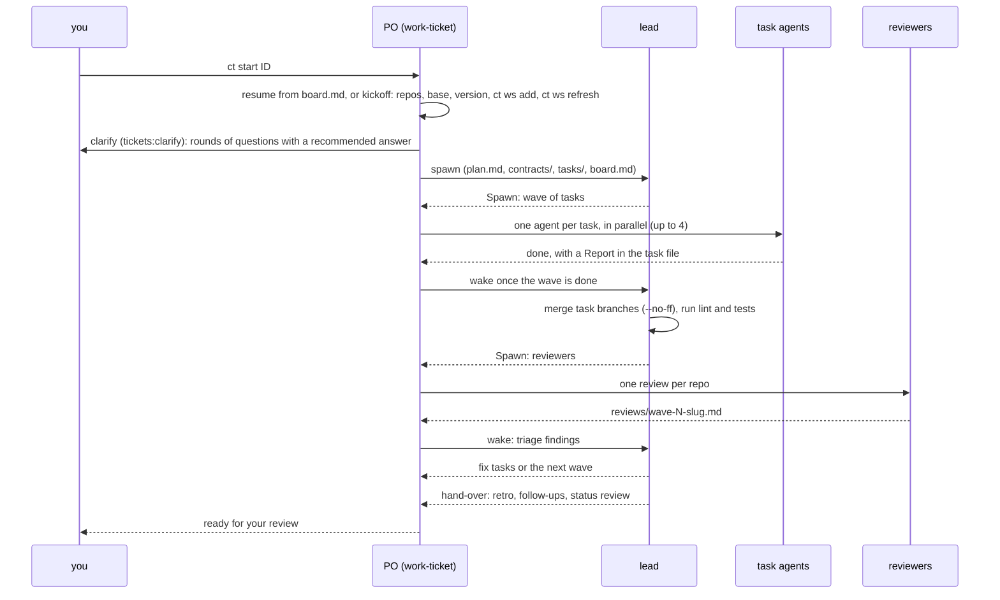
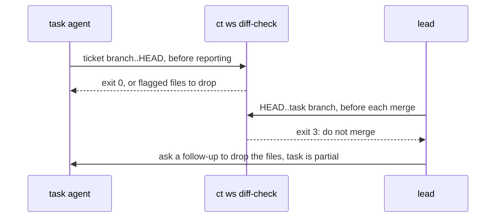

# The ticket workflow

`ct start <ID>` opens a session that runs `/tickets:work-ticket <ID>`. That session is the
product owner (PO). It talks to you, runs one lead agent, and spawns every agent the lead
asks for, because subagents cannot spawn agents. The lead plans in waves of small tasks.
Each task runs in its own worktree under `tasks/` on its own branch, and the lead merges
the finished branches into the ticket branch.

## Who writes what

- The PO owns `board.md`'s `lead:` and `po:` fields and `relay.md`, the channel between you,
  the PO and the lead. It answers status from `board.md`. While a wave runs it holds
  non-urgent requests and feedback and hands them to the lead with the wave-finished
  message; only urgent ones wake the lead mid-wave.
- The lead owns `plan.md`, `contracts/`, `tasks/` and the board rows, merges branches, and
  ends each run with a block the PO acts on (`Spawn:`, `Ask user:`, `Status:`, `Next:`).
- A task agent writes only the paths its task file `owns`, commits in its task worktree and
  fills the task's `## Report` (at most 40 lines).
- Reviewers write one file per repo under `reviews/`, with capped must-fix, should-fix and
  consider lists. A small wave (under about 150 changed lines, no contract or
  security-sensitive code) gets no reviewer: the lead checks the diff itself or leaves it
  for the next wave's review; the last wave before hand-over is always reviewed.

## Parallel tasks and the lead skill

At most 4 agents run at once. Tasks whose `owns` overlap never share a wave. Concurrent
tasks in one Go package get distinct name prefixes for their helpers and `Test` functions
(set in each task file), so the names cannot clash when the lead merges the branches.

The lead's `SKILL.md` keeps the playbook short. Detail read at one moment sits in
`reference.md` next to it, under headings `SKILL.md` points to: the board-line recipe, the
review disposition formats, the gate script that checks every review finding has a
disposition, and how each ticket type shapes the plan.

## Rules the skills enforce

- **Reports.** A task's `## Report` lists `Commits:` (one line per commit) and a `Checks:`
  line with the repo's full check command, its exit code and the short sha it ran at, after
  the last commit. A skipped check makes the task `partial`, never `done`. The PO checks that
  each finished task's report has content and flags the empty ones `NO REPORT` to the lead,
  who marks them `partial` and asks again instead of doing the work.
- **Task front matter.** `db: none|heavy`: a `heavy` task runs DB suites on a shared stack,
  so at most one runs per repo stack at a time. `fixes:` lists the backlog items and review
  findings a task closes; at merge the lead moves each backlog line to closed and marks the
  finding `resolved`.
- **Test DB.** The ticket's `conventions.md` keeps the DB environment under `## Test DB`. The
  lead passes it to reviewers, who run the DB suites with it; a skipped DB test is a
  must-fix finding when the ticket has that section or a wave task is `db: heavy`.
- **Task agents.** They install dependencies before checks (for example `npm ci` when there
  is a lockfile and no `node_modules`) and run helper scripts from their own worktree with
  worktree-relative paths, never from a main clone.
- **Commit style.** `board.md`'s `commit-style:` (`conventional`, `repo` or `ticket`) wins
  over the workspace `CLAUDE.md`, which is written before the kickoff chooses.
- **After a sandbox or container wipe.** If task worktrees or the test stack are gone, the
  PO tells the lead, and every `running` task is marked `orphaned`; the lead checks their
  branches before replanning.

## Checking a range for binary and large files

`ct ws diff-check [-C <dir>] [--max-size 1M] [--ticket <ID>] <rev-range>` walks every non-merge commit of a
range and flags each file the commit adds or modifies that git treats as binary or whose
blob is over the size limit (bytes, or a number with K, M or G; default 1M). Deletions are
ignored, so a file added and removed within the range is still reported. Each flagged file is
one stdout line, tab separated: `binary`, `large` or `binary,large`, the size in bytes, the
short sha and the path. Exit 0 means clean, 3 means something was flagged (with a count on
stderr), 1 means a usage error, a directory that is not a git checkout or a bad range.

It also prints two informational line kinds that never change the exit code: `note test-changed <name> <short sha> <path>` when a commit changes or removes a Go `Test*`, `Benchmark*`, `Fuzz*` or `Example*` func that its first parent had (or, with name `-`, an existing `testdata/**/*.txtar` file), and `note unsigned - <short sha> :commit` for a commit with no signature when `commit.gpgsign` is true.

With `--ticket <ID>` it also flags the ticket's own vault-only IDs that a commit introduces. The
set is the ID itself, the `R-nn` of the relay's entry lines (`R-nn · …`), the `B-nn` of the
backlog's item lines (`- [ ] B-nn · …`) and the finding IDs of the finding and disposition lines
of `reviews/*.md`; an ID mentioned only in prose is not in it. A commit message is flagged for
any whole-word occurrence. A file is flagged for an ID that occurs more often in the commit's
added lines of it than in its removed ones (binary files skipped), so a line kept from the base,
even reworded, passes, and a second copy of it doesn't. Each hit is a `vault-id`, the ID, the
short sha and the path (`:commit-message` for a message) line, and exit 3 applies. Paths are
raw, whatever characters they hold. Lines come per commit in `rev-list` order, a commit's size
lines before its ID lines. A generic `R-9090` that the ticket's relay doesn't have passes. A
ticket that is not in the vault is a usage error (exit 1). The skills treat a hit in a fixture
that models a ticket as a note, not a must-fix.

A task agent runs it over its own branch before reporting, with `--ticket <ID>` for a ticket that has a vault folder. The lead runs it before each merge and the wave reviewer over the diff it reviews;
on exit 3 it does not merge and asks for a follow-up that drops the files from the unpushed
task branch, unless one is expected (a lockfile) and the board line says so. On exit 1 or an
older `ct` without the command, the lead reads the commit log instead.

## Checks that run in the sandbox

Sessions often run sandboxed, as root, with no network, a signing-only key at most, and
pushes only through a host broker.

- `.tool-versions` in the workspace root pins `go`, `gofmt` and `python3` through asdf, so
  the tools work without `ASDF_*_VERSION` exports.
- Go caches live under the workspace (`.cache/go`), not in the home.
- Each repo's own `AGENTS.md` names its check command (here: `make check`, which bounds
  test parallelism with `TESTFLAGS`). Tests never rely on file permissions, since root
  ignores them.
- Commits are signed by the session when the sandbox gives it a signing-only agent;
  `/tickets:save` pushes only signed commits, see [finishing a ticket](finishing-a-ticket.md).

## Manual and synced tickets

| | Synced ticket | Manual ticket |
|---|---|---|
| Source | `ct sync` writes the note from the source | `ct new` writes it; never synced |
| Branch | `feature/<ID>[-<description>]` | `feature/<description>` (no ID) |
| `ct ws add` | `--desc` optional | needs `--desc` or `--branch` |
| Commit subject | `<ID> 
` by default | the ticket's chosen style, never an ID |
| Where its key may appear | code, commits, branches, PRs | only in the vault |

A manual ticket's key and the other vault-only IDs (task numbers, waves, relay and backlog
entries, review findings) stay out of code, docs, commit messages and pushed branch names.
For a manual ticket the kickoff asks for a commit style, recorded in `board.md`:
Conventional Commits (`type(scope): summary`) or the repo's own convention without an ID.
A synced ticket uses `<ID> 
` unless the repo's `AGENTS.md` says otherwise.
`ct ws add` refuses a manual ticket's branch that another workspace already has recorded.

Task lists cross the Jira boundary in both directions without becoming vault tasks.
`/tickets:new-ticket` files a description that has a task list as HTML (`contentFormat:
"html"`, Jira's `task-list`/`task-item` markup), because Jira turns markdown `- [ ]` items
into plain bullets. `ct sync` (and the ticket-sync skill, for HTML bodies) writes Jira task
items back as plain bullets with the state as text, `- \[ \] item` and `- \[x\] item`, so
they never show up as checkboxes in the vault's task views.

Ticket types shape the plan: a bug starts from a root cause and a failing regression test,
an investigation ends in a written finding, a chore may be one task, an epic covers other
tickets.
