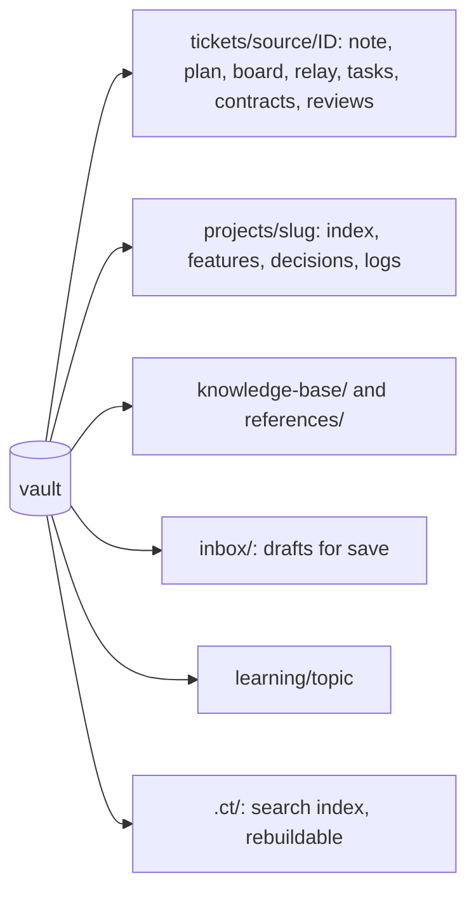

# Workspaces and the vault

## The vault

The vault is an Obsidian folder `ct vault init` scaffolds from `assets/vault-scaffold/`
(its `AGENTS.md` is the rulebook agents follow inside it). `ct vault update` keeps shipped
files current using the hash history in `assets/scaffold-history.json`, so an unedited old
copy is replaced and an edited one is kept. Per-vault settings (`workRoot`,
`projectsRoot`, `toolVersions`) live in `.workflow.json`; ticket sources in
`tickets/.sources.json`. A ticket's folder is `tickets/<source>/<ID>/`, `<source>` being
its source's key there (`jira`, `manual`, ...) and its note's `source:`; `ct vault update`
moves the folders of an older vault (`tickets/<ID>/`) under their source.

Only `/tickets:save` writes the shared notes (`projects/`, `knowledge-base/`,
`references/`). Other sessions write their ticket folder and leave drafts in `kb-drafts/`
or `inbox/`.

## A ticket workspace

`ct ws add <ID> <repo> --base <branch> [--desc <d>] [--version <v>] [--branch <b>]`
creates the ticket's worktree of a repo at `<workRoot>/<ID>/<slug>` and records the repo,
base, branch and target version in `workspace.json`. The branch is
`feature/<ID>[-<description>]` for a synced ticket and `feature/<description>` for a manual
one. `--branch` checks out an existing branch instead, for example an open PR's source. A
manual ticket's branch that another workspace has already recorded is refused, so two
tickets never share a branch.

Each `ct start`, `ct ws add`, `ct kb` and `ct teach` writes `<workRoot>/<ID>/.tool-versions`
(golang from the repos' `go.mod`, python and others from `toolVersions` in
`.workflow.json`; a tool with no installed version gets a warning and is left out). The
workspace's `CLAUDE.md` is regenerated on every start and names the vault, the repos, the
code graph and the Git rules.

Task worktrees live under `<ID>/tasks/<slug>-<n>`, are created and removed by the lead,
and are merged into the ticket branch. `ct ws rm` removes a workspace (refusing dirty or
unpushed work without `--force`), `ct ws gc` frees disk, `ct ws fetch` refreshes the main
clones on the host. The tidy skill's scratch clones (`tasks/tidy-<slug>`) are removed with
`ct ws tidy-clean <ID>`.

## Repo slugs

A repo is named `<provider>-<owner>-<repo>`, from its origin URL. The slug names the vault
project folder, the worktree folder, version tags and graph node ids. `ct layout` moves
main clones to `<projectsRoot>/<provider>/<owner>/<repo>`.

## Cleanup

`ct clean` removes a closed ticket's workspace once its work is saved and pushed, then
moves a synced ticket's folder to `.trash/` and a manual one's to `archive/tickets/<source>/<ID>/`.
