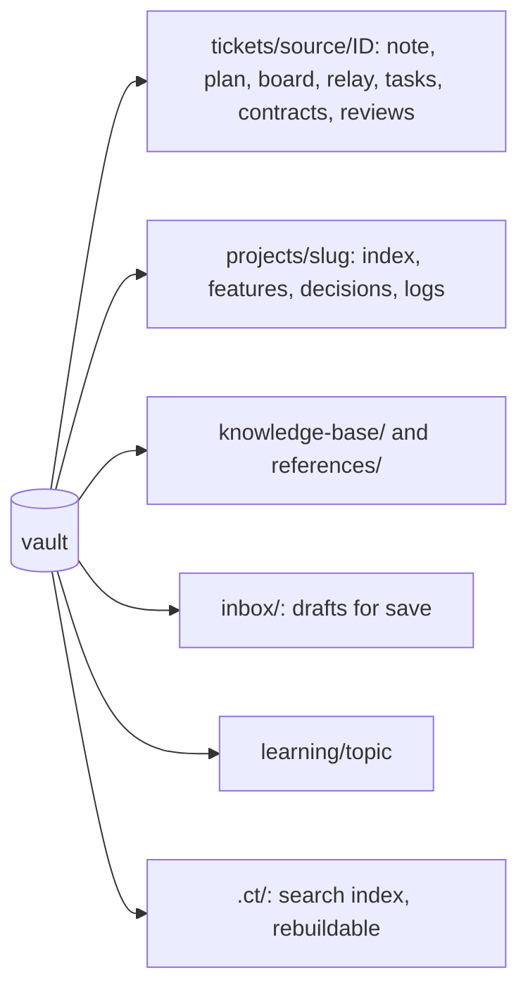
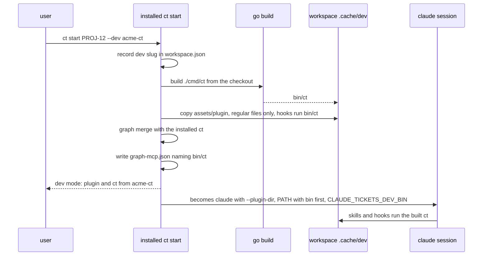

# Workspaces and the vault

## The vault

The vault is an Obsidian folder `ct vault init` scaffolds from `assets/vault-scaffold/`
(its `AGENTS.md` is the rulebook agents follow inside it). `ct vault update` keeps shipped
files current using the hash history in `assets/scaffold-history.json`, so an unedited old
copy is replaced and an edited one is kept. Per-vault settings (`workRoot`,
`projectsRoot`, `toolVersions`) live in `.workflow.json`; ticket sources in
`tickets/.sources.json`. A ticket's folder is `tickets/<source>/<ID>/`, `<source>` being
its source's key there (`jira`, `manual`, ...) and its note's `source:`; `ct vault update`
moves the folders of an older vault (`tickets/<ID>/`) under their source.

Only `/tickets:save` writes the shared notes (`projects/`, `knowledge-base/`,
`references/`). Other sessions write their ticket folder and leave drafts in `kb-drafts/`
or `inbox/`.

## A ticket workspace

`ct ws add <ID> <repo> --base <branch> [--desc <d>] [--version <v>] [--branch <b>]`
creates the ticket's worktree of a repo at `<workRoot>/<ID>/<slug>` and records the repo,
base, branch and target version in `workspace.json`. The branch is
`feature/<ID>[-<description>]` for a synced ticket and `feature/<description>` for a manual
one. `--branch` checks out an existing branch instead, for example an open PR's source. A
manual ticket's branch that another workspace has already recorded is refused, so two
tickets never share a branch.

Each `ct start`, `ct ws add`, `ct kb` and `ct teach` writes `<workRoot>/<ID>/.tool-versions`
(golang from the repos' `go.mod`, python and others from `toolVersions` in
`.workflow.json`; a tool with no installed version gets a warning and is left out). The
workspace's `CLAUDE.md` is regenerated on every start and names the vault, the repos, the
code graph and the Git rules.

Task worktrees live under `<ID>/tasks/<slug>-<n>`, are created and removed by the lead,
and are merged into the ticket branch. `ct ws rm` removes a workspace (refusing dirty or
unpushed work without `--force`), `ct ws gc` frees disk, `ct ws fetch` refreshes the main
clones on the host. `ct ws refresh <ID>` rewrites the workspace's `CLAUDE.md` from the vault
exactly as `ct start` does and touches nothing else; the kickoff runs it once `board.md`
names the ticket's commit style, so the Git rules in `CLAUDE.md` are current. The tidy skill's scratch clones (`tasks/tidy-<slug>`) are removed with
`ct ws tidy-clean <ID>`.

### Dev workspaces

A ticket that changes claude-tickets itself would otherwise run its agents on the installed
plugin and `ct`, so its own new rules never apply while it is worked. `ct start <ID> --dev
<slug>` records `"dev": {"slug": "<slug>"}` in `workspace.json` (omitted when off; `--dev
none` clears it), where `<slug>` is a repo of the workspace with `cmd/ct` and
`assets/plugin`. Every start of a dev workspace then builds `ct` from that checkout into
`.cache/dev/bin` (the workspace's Go env; a failed build fails the start, nothing falls
back), copies the checkout's `assets/plugin` to `.cache/dev/plugin` with its hooks running
the built `ct` by path, and gives the sessions that plugin, `.cache/dev/bin` prepended to
the `PATH` they start with (expanded where `claude` starts, not a copy of `ct start`'s own),
and a code graph served by the built `ct` (named by path in `.claude/graph-mcp.json`).
`ct start` prints `dev mode: plugin and ct from <slug> (<short HEAD>[-dirty])`. The
sessions also get `CLAUDE_TICKETS_DEV_BIN=<workspace>/.cache/dev/bin`: a sandbox or
container wrapping `claude` that sets its own `PATH` prepends it (the path is in the
workspace, so it exists inside too); otherwise skills and hooks run the installed `ct`.

The installed `ct` never runs the built binary or other checkout code outside a session:
it only builds (the go.mod toolchain and module downloads still run on the host) and copies
regular files and dirs (a symlink or other special file in `assets/plugin`, or
`assets/plugin` itself a link, fails the start with an error naming it), and the copy
refuses to replace a `.cache/dev/plugin` that isn't a plugin. The graph merge at each start
therefore runs in the installed `ct`; a branch that changes the merged graph is tested by
running `ct graph merge <workspace>` inside the session (with that branch's ct on PATH).
`ct graph merge <workspace>` brings that workspace's merged graph up to date, exactly what
`ct start` does before a session, with progress on stderr (exit 0 merged, 1 for no vault
context, an unknown workspace or a failed merge); the workspace is resolved as in `ct graph mcp`. A running
session keeps the build it started with: `ct start` refuses a ticket whose session runs, so
every start builds and copies afresh. `ct clean --save` ignores `dev`: its unattended `/tickets:save`
runs on the installed plugin and `ct`. An unknown `<slug>` fails with `<slug> is not a repo
of <ID>'s workspace (ct ws add first)`.

## Worktree code graphs

Graphify writes each ticket worktree's graph outside the worktree, to
`<workRoot>/<ID>/.cache/graphify/<slug>/graphify-out`, through `GRAPHIFY_OUT`, so formatters
and `git status` never see it. `ct ws add` seeds that folder from the main clone's
`graphify-out` (cache, manifest, and `graph.json` last, so a half copy is retried). `ct ws gc`
drops `.cache`; the next start re-seeds each worktree from its main clone and runs an
incremental update. A `<worktree>/graphify-out` left by an older version is moved to the new
place, or removed when the new one already has content. Main clones and `ct kb repo`
exploration clones keep `<repo>/graphify-out`. A path not listed in `workspace.json` is
skipped, and logged once. The merge is in [the architecture](architecture.md#code-graph).

## Repo slugs

A repo is named `<provider>-<owner>-<repo>`, from its origin URL. The slug names the vault
project folder, the worktree folder, version tags and graph node ids. `ct layout` moves
main clones to `<projectsRoot>/<provider>/<owner>/<repo>`.

## Cleanup

`ct clean` removes a closed ticket's workspace once its work is saved and pushed, then
moves a synced ticket's folder to `.trash/` and a manual one's to `archive/tickets/<source>/<ID>/`.
