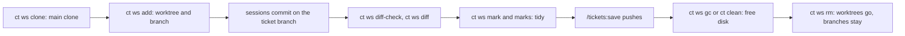

# Workspace commands: ct ws

`ct ws` manages the git worktrees of ticket workspaces. A workspace is
`<workRoot>/<ID>/` with one worktree per repo (branched from the repo's base), task
worktrees under `tasks/`, `workspace.json` and `.cache/`. Layout and graphs are in
[workspaces and the vault](workspace-and-vault.md); the hardening git runs under is in
[git hardening](git-hardening.md).

| Command | Does |
|---|---|
| `ct ws repos` | list the main clones: slug and `<provider>/<owner>/<repo>` |
| `ct ws clone <provider>/<owner>/<repo>` or `--url <git url>` | clone into `<projectsRoot>/<provider>/<owner>/<repo>` and build its graph |
| `ct ws add <ID> <repo> --base <branch> ...` | create or reuse the ticket's worktree |
| `ct ws ls [<ID>]` | worktrees: branch, uncommitted changes, ahead/behind the base |
| `ct ws diff <ID> [--stat]` | everything changed on the ticket's branches since they left the base |
| `ct ws fetch [<repo>...]` | fetch origin in the main clones (and pass refs to older shared clones) |
| `ct ws refresh <ID>` | rewrite the workspace's `CLAUDE.md` from the vault (commit style, repos) |
| `ct ws mark`, `marks` | the tidy mark, see [finishing a ticket](finishing-a-ticket.md) |
| `ct ws tidy-clean <ID>` | remove tidy's scratch clones under `tasks/` |
| `ct ws diff-check` | flag binary, large and vault-only-ID changes in a range |
| `ct ws rm <ID>`, `ct ws gc` | remove a workspace, free disk |

## add

`ct ws add <ID> <repo> --base <branch> [--desc <text>] [--version <target>] [--branch <existing>]`
branches from `origin/<base>` (the local base when there is no such remote branch) and
reuses the branch if it exists. The branch is `feature/<ID>[-<description>]` for a synced
ticket and `feature/<description>` for a manual one (so `--desc` or `--branch` is
required there); a branch another workspace already records for that repo is refused.
`--branch` checks out an existing branch instead (an open PR's source) and `--base` is
then what it merges into. It copies untracked files matching the main clone's
`.worktreeinclude` (such as `.env`), seeds the worktree's code graph from the main clone
and records repo, base, branch and target version in `workspace.json`. It only creates
worktrees; it no longer falls back to a shared clone (older workspaces' shared clones still
work). A session clones a new repo with `ct ws clone` first.

## rm

`ct ws rm <ID> [--drop-ignored]` removes the worktrees and workspace files; branches are
kept. Every guard is checked and a refusal lists all that apply: uncommitted changes
(modified and untracked), a checked-out submodule, ignored files (`.env`, local configs)
that removal would delete and, for an older shared clone, commits not on origin.
`--drop-ignored` lifts only the ignored-files stop. Nothing else is skippable: commit,
push or stash the work, or remove the directory by hand.

## gc

`ct ws gc [--days N] [--dry-run]` (host only, refused inside a container) frees disk:

- workspaces of tickets whose note says `done` or `closed` and that are idle for N days
  (default 14), through the same guards as `rm`. A workspace kept for dirty or unpushed
  work is listed in a follow-up note in the vault's `inbox/`;
- merged graphs and caches of sessions that aren't running (a stopped session's `.cache`
  goes too; the next start re-seeds each worktree graph from its main clone);
- idle `ct spec` exploration clones;
- graphify's dated snapshots older than a week.

A session counts as running when its process (`ct start`, `ct teach`, `ct spec`) is alive on
this host, else when its hook state (`.agent-state`) is under a day old and not exited.
Ignored files of yours move to the vault's `.trash/<ID>-ignored-files/` instead of being
deleted. `ct clean` frees the closed tickets' workspaces the same way, after they are saved.

## diff-check

`ct ws diff-check [-C <dir>] [--max-size 1M] [--ticket <ID>] <rev-range>` walks the commits of
a range. Flagged lines make exit 3; notes never do; a usage error, a non-checkout or a bad
range exit 1.

| Line | Meaning |
|---|---|
| `binary`, `large`, `binary,large`, size, short sha, path | a file a commit adds or modifies that git treats as binary or whose blob is over the limit |
| `vault-id`, ID, short sha, path or `:commit-message` | with `--ticket`, the ticket's own vault-only IDs (the key, relay `R-nn`, backlog `B-nn`, review finding IDs) that a commit introduces; a line kept from the base passes |
| `spec-id`, REQ-ID, short sha, spec file | for `A..B` or `A...B`, a requirement ID that B adds but A already defines, or that B defines twice |
| `note test-changed <name> <sha> <path>` | a commit changes or removes a Go `Test*`, `Benchmark*`, `Fuzz*` or `Example*` func that its first parent had; name `-` stands for a `testdata/**/*.txtar` file or a test file that couldn't be parsed |
| `note unsigned - <sha> :commit` | a commit with no signature, printed only when `commit.gpgsign` is true in that checkout |

The usage by agents is in [the ticket workflow](ticket-workflow.md#checking-a-range-for-binary-and-large-files).
